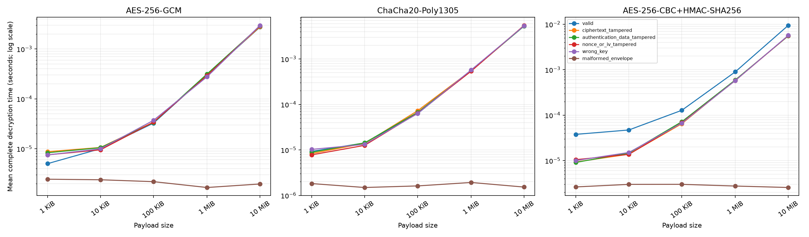

# Cryptography Under Adversarial Conditions

**RMIT COSC2539 - Assignment 1: Analytical Security Report**

**Student:** [Name and student ID]

**AI-assisted sections:** identified with [AI-1]; complete the citation fields in Acknowledgements.

## Abstract

This report compares three cryptographic categories under controlled payload-size and tampering experiments: SHA-256, SHA3-256, and BLAKE2b-256; AES-256-GCM, ChaCha20-Poly1305, and AES-256-CBC + HMAC-SHA256; and RSA-OAEP, ECDH P-256, or X25519 combined with AES-256-GCM. Across the authoritative runs, 450, 900, and 900 RQ1 timings were collected for Hashing, Symmetric, and Asymmetric-based hybrid encryption. Their repeated-measures ANOVA tests were significant after within-category Holm correction, but residual normality was rejected and all analyses require caution. Tested symmetric and hybrid invalid envelopes were rejected without plaintext release. Hashing detected modified data against a trusted digest, but an attacker-recomputed unkeyed digest matched modified data. RQ3 yielded 0/45, 36/75, and 17/60 Holm-significant comparisons, respectively; timing inference remains exploratory or conditional. These results describe the implementations and one machine, not a universal speed ranking or a security proof. [AI-1]

## 1. Background and research questions

Cryptography provides different services through different operations. A hash maps data to a fixed-size digest; symmetric authenticated encryption protects messages with a shared key; asymmetric-based hybrid encryption uses public-key mechanisms to establish or protect a symmetric key, then uses symmetric encryption for the payload. Timing those operations as though they were the same task would create a misleading ranking. This report therefore compares each category within its own measured scope, using controlled inputs and randomized blocks. Randomized benchmarking can reduce order-related bias, but cannot remove operating-system effects or guarantee independent observations [1].

The nine selected constructions represent three hash families, two common authenticated-encryption designs, an Encrypt-then-MAC design, and three public-key key establishment/key-protection approaches using the same payload cipher. The choices permit comparisons of distinct mechanisms while keeping payload sizes and, within each category, input bytes matched. They do not represent every implementation or configuration.

The report addresses these approved questions:

- **RQ1:** How does input data size affect the execution time of selected cryptographic algorithms?
- **RQ2:** How do selected cryptographic schemes respond to tampered data and invalid ciphertext?
- **RQ3:** How do integrity verification and rejection of invalid inputs affect the processing time of selected cryptographic schemes under adversarial conditions?

This is an empirical implementation study. Passing a finite set of tests does not prove security, and local timing differences alone do not demonstrate a remotely exploitable side channel. [AI-1]

## 2. Data collection and experimental methodology

### 2.1 Schemes and security roles

**Hashing.** SHA-256 and SHA3-256 follow NIST standards; BLAKE2b is configured for a 32-byte result [2]-[5]. All produce 256-bit digests. Hashing provides neither confidentiality nor sender authentication. A digest detects a change only when the reference digest is trusted. If an attacker can replace both the message and an unkeyed digest, the attacker can compute a matching pair. HMAC is a keyed integrity/authentication mechanism, but does not identify one particular sender among parties sharing its key [6]. [AI-1]

**Symmetric encryption.** AES-256-GCM and ChaCha20-Poly1305 are authenticated-encryption constructions, selected to represent two widely used AEAD mechanisms [7]-[10]. They encrypt payloads and authenticate ciphertext and associated data; a valid tag does not establish a human sender identity. AES-256-CBC + HMAC-SHA256 represents a separate Encrypt-then-MAC construction. It uses independent encryption and MAC keys, PKCS#7 padding, and authenticates the IV and ciphertext. The implementation verifies the MAC in constant time before CBC decryption or unpadding [6], [11]. This ordering prevents unauthenticated ciphertext from reaching padding validation. [AI-1]

**Asymmetric-based hybrid encryption.** RSA-OAEP with SHA-256 wraps a fresh AES-256 session key; RSA does not encrypt the large payload. ECDH P-256 and X25519 establish a shared secret, HKDF-SHA256 derives a 256-bit key, and AES-256-GCM encrypts/authenticates the payload [12]-[15]. The evaluated ECDH/X25519 schemes use an ephemeral sender key and a static recipient key. They do not add a sender signature or replay protection, and later compromise of the recipient private key can expose recorded exchanges; this design does not provide forward secrecy against that compromise. [AI-1]

### 2.2 Inputs, blocks, and environment

No external dataset was scraped. The runners generated seeded pseudo-random byte buffers before timing and saved measured observations to CSV. The five payload sizes were 1 KiB, 10 KiB, 100 KiB, 1 MiB, and 10 MiB (1,024 through 10,485,760 bytes). Within each block and size, schemes in a category received the same bytes. Cryptographic keys and nonce/IV values used cryptographic randomness, independent of experimental seeds.

Each performance experiment used 30 complete blocks, five warm-ups excluded from measured CSVs, and randomized condition order within blocks. Raw sample counts were 450 Hashing RQ1 observations, 900 Symmetric, and 900 Asymmetric hybrid. Warm-up exposure differed: Hashing and Asymmetric warmed each condition before measured blocks; Symmetric warmed each condition within each block. This is a cross-category comparability limitation.

The recorded environment was Gentoo Linux, kernel 6.18.60, Intel Core i5-13420H, and CPython 3.14.10. Symmetric/Asymmetric metadata recorded OpenSSL 3.6.5 and cryptography 50.0.2; NumPy 2.5.5 and SciPy 1.18.1 were used for analysis, with statsmodels 0.15.0 for the Asymmetric adjusted model. Hashing metadata did not record its hash-library backend version. Only one machine/software environment was evaluated. [AI-1]

### 2.3 Timing boundaries and adversarial cases

All measured intervals used `time.perf_counter()`. Input creation, key provisioning, attack mutation, CSV output, and statistical analysis were excluded.

| Category | RQ1 timing | RQ3 timing |
|---|---|---|
| Hashing | Digest call; hex formatting excluded. | Digest calculation plus comparison with a supplied digest. Attacker-side digest recomputation excluded. |
| Symmetric | Full per-message encrypt/decrypt call. Encryption includes nonce/IV generation, padding, encryption, and tag/MAC creation; decryption includes validation, authentication, decryption, and unpadding where reached. | Complete decrypt attempt, including early parsing/validation and the failure path. Authentication cost is not isolated. |
| Hybrid | RSA encryption: AES-key generation, AES-GCM, OAEP wrapping. RSA decryption: OAEP unwrap and AES-GCM. ECDH/X25519: ephemeral key generation/agreement, HKDF, and AES-GCM. Long-term recipient key generation excluded. | Complete decrypt attempt through parsing, key recovery/agreement, HKDF, and AES-GCM stages reached. |

RQ2 used trusted-digest and attacker-recomputed-digest scenarios for hashing; valid, ciphertext/tag/IV-or-nonce, wrong-key, and malformed cases for Symmetric; and ciphertext/tag, wrapped-key or public-key changes, and malformed envelopes for the hybrid schemes. RQ3 kept invalid scenarios separate by failure path. The hashed third scenario times verification against an already recomputed digest; it excludes the attacker's digest generation. [AI-1]

## 3. Data analysis

For RQ1, each algorithm or scheme-operation combination was tested separately using one-factor repeated-measures ANOVA: input size was the five-level within-block factor and block was the subject. Mauchly's test assessed sphericity; all tests rejected it, so Greenhouse-Geisser (GG) corrected degrees of freedom and p-values were used [16]. Holm correction was applied within category families of 3 Hashing, 6 Symmetric, and 6 hybrid omnibus tests [17]. Tests used α = .05 and reported partial eta-squared. A significant omnibus result establishes only that at least one mean differs, not which pair.

Hashing and Symmetric also report Friedman repeated-block rank tests. These are rank-based corroboration, not ANOVA tests of arithmetic means [18]. The hybrid category additionally reports a position-adjusted block-fixed-effects OLS model with CR1 cluster-robust covariance as sensitivity analysis; it is not conventional repeated-measures ANOVA. Its input-size tests adjust for randomized position. All six OLS omnibus tests remained significant after Holm correction; RSA encryption/decryption Wald F values were 213.32/459.14, ECDH 113.51/185.78, and X25519 204.95/310.55. Pairwise OLS contrasts were omitted for RSA because diagnostics were flagged.

For RQ3, observations were paired within block, algorithm/scheme, size, and scenario. Holm families were 45 Hashing, 75 Symmetric, and 60 hybrid comparisons at α = .05. Hashing's sign-flip test depends on sign exchangeability/symmetry and is not an exact design-based test of condition assignment. Symmetric and hybrid label-swap tests are conditional on their generated schedules and a sharp no-effect null. All require caution about finite-state PRNG assignment and no consequential carry-over. Diagnostics showed temporal structure: a Hashing block trend, maximum within-size lag-1 correlation 0.422 for Symmetric RQ3, and hybrid block lag-1 correlation 0.426 (p = .0213). These limitations downgrade RQ3 inference to exploratory/conditional. A non-significant test does not establish equivalence. Residual normality diagnostics used Shapiro-Wilk [19]; they rejected normality. GG correction addresses sphericity only, not normality or temporal dependence. [AI-1]

## 4. Results and discussion

### 4.1 RQ1: Input size and execution time

Every 10 MiB mean exceeded its corresponding 1 KiB mean. Hashing and Symmetric means rose at each tested size. Hybrid decryption was not strictly monotonic at the smallest sizes: RSA-OAEP decreased slightly from 1.580 ms at 1 KiB to 1.574 ms at 10 KiB; X25519 decreased from 0.06793 ms to 0.06515 ms before both rose at larger sizes.

| Category | 1 KiB mean → 10 MiB mean (ms) | Repeated-measures result |
|---|---|---|
| Hashing | SHA-256 0.00266 → 4.83394; SHA3-256 0.00363 → 16.37492; BLAKE2b-256 0.00370 → 9.53853 | All 3 significant; Holm p = 1.82×10⁻⁵² to 2.17×10⁻³⁶; partial η² = .996–.9996 |
| Symmetric, encrypt/decrypt | AES-GCM .01146/.00726 → 2.764/2.816; ChaCha20-Poly1305 .01049/.00781 → 5.396/5.369; CBC-HMAC .03321/.02830 → 14.012/9.592 | All 6 significant; Holm p = 5.60×10⁻³⁸ to 1.93×10⁻²⁷; partial η² = .980–.999 |
| Hybrid, encrypt/decrypt | RSA .07737/1.57991 → 3.453/4.869; ECDH .14058/.11024 → 3.483/3.506; X25519 .11464/.06793 → 3.403/3.457 | All 6 significant; Holm p = 5.33×10⁻⁴⁰ to 8.33×10⁻²¹; partial η² = .949–.976 |

Times in this table are means; full medians and descriptive statistics are in the category analysis CSVs, and Appendix A gives the full RM-ANOVA table. The omnibus tests support an input-size effect within each measured series, subject to assumption failures. Friedman supplements were also significant for all three Hashing algorithms and all six Symmetric series; their rank-based hypotheses do not establish differences in arithmetic means. Sphericity and residual normality were rejected in all models; Hashing's saved RM-ANOVA did not include difference-score normality diagnostics. Symmetric and hybrid difference-score diagnostics also rejected normality. Symmetric RQ1 also had a maximum within-size lag-1 correlation of .517, indicating possible temporal dependence. Hashing Levene tests rejected equal residual variances for SHA-256 and SHA3-256 but not BLAKE2b-256; Levene is not a sphericity test. No cross-category or between-scheme significance tests were run.

The mechanism explains the broad pattern but was not timed separately. Hashing processes the payload to compute a digest. AEAD encryption/decryption processes the payload once for authenticated protection. CBC-HMAC performs a MAC pass as well as CBC/padding work; its larger observed times are consistent with this extra pass, but the experiment did not isolate component costs. Hybrid operations include key wrapping or key agreement and HKDF in addition to AES-GCM. RSA's measured public-key operation is key wrapping, not encryption of the 10 MiB payload. Therefore, the endpoint times are not a universal speed ranking: the measured operations differ. [AI-1]

*Figure 1. Symmetric mean execution time by size and operation. Within-category series only; no between-scheme test was conducted.*

### 4.2 RQ2: Tampering and invalid-input responses

| Category | Observed functional outcomes | Mechanism and interpretation |
|---|---|---|
| Hashing | The documented RQ2 design has **30 functional checks** (3 algorithms × 5 sizes × 2 scenarios × 1 check): all 30 configurations are present. Of these, 15/15 modified inputs compared with the original trusted digest were rejected; 15/15 comparisons against an attacker-recomputed digest passed. RQ3 is separate: 1,350 timing observations, 450 per scenario. | A digest detects change only relative to a trusted reference. Because an unkeyed hash uses no secret, an attacker who can replace both data and digest can recompute a matching digest; this does not authenticate the data's source. |
| Symmetric | 90 cases: 15 valid accepted; all 75 invalid rejected; no invalid plaintext released. 60 failures were at authentication and 15 at envelope validation. | GCM/Poly1305 reject invalid tags/ciphertext. CBC-HMAC rejects modified authenticated material before CBC decryption/unpadding. |
| Hybrid | 85 cases: 15 valid accepted; all 70 invalid rejected without plaintext release. | RSA wrapped-key changes failed OAEP unwrap; malformed public keys failed parsing; valid replacement ECDH/X25519 keys reached GCM and failed authentication. |

The standalone Hashing RQ2 CSV contains the complete documented matrix: one functional check for each algorithm-size-scenario combination. RQ3 separately records timing observations and their verification outcomes; those measurements are not added to the RQ2 functional count. [AI-1]

The outcomes demonstrate only tested behavior. AEAD and HMAC protect message integrity/confidentiality under key assumptions; shared-key verification does not identify a specific human sender. Hybrid encryption lets anyone with a recipient's public key create a ciphertext for that recipient; without signatures, acceptance does not establish sender identity. None of these experiments tested replay defense. No formal proof or exhaustive malformed-input assessment was conducted. [AI-1]

### 4.3 RQ3: Processing time under adversarial conditions

| Category | Observations and Holm results | Interpretation |
|---|---|---|
| Hashing | 1,350 timings; 0/45 comparisons significant; smallest adjusted p = .3915. At 10 MiB, modified/trusted minus valid means: SHA-256 −96.08 µs (−1.96%); SHA3-256 +64.51 µs (+0.38%); BLAKE2b-256 +16.25 µs (+0.17%). | No adjusted difference detected; this is not evidence of equal times. Attacker digest computation was outside the interval. Block trend ρ = .581, p = .00075 makes inference exploratory. |
| Symmetric, corrected raw run `run_20261119_02` | 2,700 timings; 36/75 significant. AES-GCM: ciphertext tampering at 1/5 sizes and malformed inputs at 5/5; ChaCha: malformed 5/5; CBC-HMAC: all five invalid scenarios at all five sizes. | Failure paths have different costs. At 10 MiB, malformed envelopes averaged 1.97 µs for AES-GCM and 1.52 µs for ChaCha, compared with valid means 2.748 and 5.315 ms. CBC-HMAC ciphertext tampering averaged 5.592 ms versus 9.463 ms valid because failed MAC verification bypassed CBC decryption. |
| Hybrid | 2,250 timings; 17/60 significant: all 15 malformed-input contrasts and 2 key-material contrasts; none for ciphertext or tag changes. | Malformed inputs may stop before key processing/GCM; OAEP and agreement/GCM failures reach different stages. Lag-1 dependence (ρ = .426, p = .0213) downgrades all tests to conditional/exploratory. |

These times cover each complete attempted decryption/verification workflow, not isolated “integrity overhead.” In particular, malformed structures can fail during parsing, while a well-formed tampering attempt may reach OAEP, key agreement/HKDF, GCM, or HMAC. The number of significant tests is conditional on the tested schedules and analysis assumptions. Non-significance is not equivalence, and a microsecond-scale local difference does not prove a practical remote timing vulnerability. [AI-1]

### 4.4 Limitations and security implications

The measurements came from one machine and software environment using seeded pseudo-random payloads, not representative application files or streaming workloads. System load, CPU frequency, caches, and thermal state can affect timings. Randomized condition order does not guarantee independent blocks or eliminate carry-over. Warm-up schedules differed across categories.

The Symmetric implementation generated a fresh nonce/IV using cryptographic randomness for each encryption call, but the actual values were not persisted. Source inspection confirmed generation; the audit could not independently verify per-key uniqueness or rule out a random collision. Collision risk at the observed scale is very low, not zero. Future runs should record non-secret nonce/IV values or check uniqueness automatically.

The report does not establish sender authentication, replay protection, hybrid forward secrecy against later compromise of static recipient private keys, or resistance to attacks outside the test matrix. Hashing's backend version is missing from metadata. The ANOVA assumptions were not all satisfied, and RQ3 dependence diagnostics require exploratory/conditional interpretation. Timing differences alone are not evidence of an exploitable side channel. No formal security proof was conducted. [AI-1]

## 5. Conclusion

Across all nine implementations, the 10 MiB mean exceeded the 1 KiB mean, with slight 10 KiB dips in two hybrid decryption series. The experiments show distinct security roles: hashes require a trusted digest; AEAD and CBC-HMAC rejected tested tampering without releasing plaintext; hybrid schemes combined public-key key processing with AES-GCM payload protection. RQ3 differences varied by failure stage and category, but dependence and assignment limitations prevent confirmatory or equivalence claims. These findings answer the RQs only for the tested code, conditions, and host. [AI-1]

## References

Bibliographic entries were compiled with AI assistance and checked against the linked publications and standards; the student must complete the prompt citation and verify the final list [AI-1].

[1] T. Kalibera and R. E. Jones, “Rigorous benchmarking in reasonable time,” in *Proc. ACM SIGPLAN Int. Symp. Memory Management (ISMM)*, 2013, pp. 63–74, doi: 10.1145/2464157.2464160.

[2] National Institute of Standards and Technology, *Secure Hash Standard (SHS)*, FIPS PUB 180-4, Aug. 2015. [Online]. Available: https://csrc.nist.gov/pubs/fips/180-4/upd1/final

[3] National Institute of Standards and Technology, *SHA-3 Standard: Permutation-Based Hash and Extendable-Output Functions*, FIPS PUB 202, Aug. 2015. [Online]. Available: https://csrc.nist.gov/pubs/fips/202/final

[4] M.-J. O. Saarinen and J.-P. Aumasson, “The BLAKE2 cryptographic hash and message authentication code (MAC),” RFC 7693, Nov. 2015. [Online]. Available: https://www.rfc-editor.org/rfc/rfc7693

[5] J.-P. Aumasson, S. Neves, Z. Wilcox-O’Hearn, and C. Winnerlein, “BLAKE2: Simpler, smaller, fast as MD5,” in *Applied Cryptography and Network Security*, LNCS 7954, 2013, pp. 119–135, doi: 10.1007/978-3-642-38980-1_8.

[6] H. Krawczyk, M. Bellare, and R. Canetti, “HMAC: Keyed-hashing for message authentication,” RFC 2104, Feb. 1997. [Online]. Available: https://www.rfc-editor.org/rfc/rfc2104

[7] National Institute of Standards and Technology, *Advanced Encryption Standard (AES)*, FIPS PUB 197, updated May 2023. [Online]. Available: https://csrc.nist.gov/pubs/fips/197/final

[8] M. Dworkin, *Recommendation for Block Cipher Modes of Operation: Galois/Counter Mode (GCM) and GMAC*, NIST SP 800-38D, Nov. 2007. [Online]. Available: https://csrc.nist.gov/pubs/sp/800/38/d/final

[9] Y. Nir and A. Langley, “ChaCha20 and Poly1305 for IETF protocols,” RFC 8439, June 2018. [Online]. Available: https://www.rfc-editor.org/rfc/rfc8439

[10] Python Cryptographic Authority, *cryptography 50.0.2 documentation*, 2026. [Online]. Available: https://cryptography.io/en/50.0.2/

[11] M. Dworkin, *Recommendation for Block Cipher Modes of Operation: Methods and Techniques*, NIST SP 800-38A, Dec. 2001. [Online]. Available: https://csrc.nist.gov/pubs/sp/800/38/a/final

[12] K. Moriarty, B. Kaliski, J. Jonsson, and A. Rusch, “PKCS #1: RSA Cryptography Specifications Version 2.2,” RFC 8017, Nov. 2016. [Online]. Available: https://www.rfc-editor.org/rfc/rfc8017

[13] A. Langley, M. Hamburg, and S. Turner, “Elliptic curves for security,” RFC 7748, Jan. 2016. [Online]. Available: https://www.rfc-editor.org/rfc/rfc7748

[14] H. Krawczyk and P. Eronen, “HMAC-based extract-and-expand key derivation function (HKDF),” RFC 5869, May 2010. [Online]. Available: https://www.rfc-editor.org/rfc/rfc5869

[15] E. Barker, L. Chen, A. Roginsky, A. Vassilev, and R. Davis, *Recommendation for Pair-Wise Key-Establishment Schemes Using Discrete Logarithm Cryptography*, NIST SP 800-56A Rev. 3, Apr. 2018. [Online]. Available: https://csrc.nist.gov/pubs/sp/800/56/a/r3/final

[16] S. Greenhouse and S. Geisser, “On methods in the analysis of profile data,” *Psychometrika*, vol. 24, no. 2, pp. 95–112, 1959, doi: 10.1007/BF02289823.

[17] S. Holm, “A simple sequentially rejective multiple test procedure,” *Scandinavian Journal of Statistics*, vol. 6, no. 2, pp. 65–70, 1979, doi: 10.2307/4615733.

[18] M. Friedman, “The use of ranks to avoid the assumption of normality implicit in the analysis of variance,” *Journal of the American Statistical Association*, vol. 32, no. 200, pp. 675–701, 1937, doi: 10.1080/01621459.1937.10503522.

[19] S. S. Shapiro and M. B. Wilk, “An analysis of variance test for normality (complete samples),” *Biometrika*, vol. 52, nos. 3–4, pp. 591–611, 1965, doi: 10.1093/biomet/52.3-4.591.

## Acknowledgements and AI disclosure

**Acknowledgements:** [Student: acknowledge assistance/funding, or state that there was none.]

**AI use:** AI assistance was used to summarize project evidence, organize sections, and draft text. It did not generate experiment observations. Sections marked [AI-1] contain AI-assisted text and must be checked and revised by the student.

[AI-1] “[Insert the exact prompt text or prompt texts used for report drafting; the verbatim prompts and dates must be completed from the project chat history.]” ChatGPT, [version], OpenAI, [Day Month Year], chat.openai.com.

## Appendix A. Full RQ1 repeated-measures results

The following values are transcribed from the authoritative RM-ANOVA outputs. Adjusted p-values are Holm-corrected within each category. The complete diagnostics are in the source CSVs cited below. [AI-1]

| Category / operation | F | GG df (numerator, denominator) | Holm-adjusted p | Partial η² |
|---|---:|---:|---:|---:|
| Hash SHA-256 | 24904.48 | 1.014, 29.408 | 2.15×10⁻⁴⁴ | .99884 |
| Hash SHA3-256 | 78241.53 | 1.033, 29.966 | 1.82×10⁻⁵² | .99963 |
| Hash BLAKE2b-256 | 7197.35 | 1.002, 29.070 | 2.17×10⁻³⁶ | .99599 |
| AES-GCM encrypt | 2240.42 | 1.068, 30.983 | 1.56×10⁻³⁰ | .98722 |
| AES-GCM decrypt | 1395.97 | 1.057, 30.661 | 1.93×10⁻²⁷ | .97965 |
| ChaCha encrypt | 3806.93 | 1.071, 31.057 | 5.74×10⁻³⁴ | .99244 |
| ChaCha decrypt | 7446.18 | 1.063, 30.830 | 5.60×10⁻³⁸ | .99612 |
| CBC-HMAC encrypt | 26684.14 | 1.128, 32.708 | 3.70×10⁻⁴⁹ | .99891 |
| CBC-HMAC decrypt | 5686.97 | 1.027, 29.770 | 4.31×10⁻³⁵ | .99493 |
| RSA hybrid encrypt | 644.63 | 1.043, 30.260 | 1.39×10⁻²¹ | .957 |
| RSA hybrid decrypt | 1192.94 | 1.689, 48.980 | 5.33×10⁻⁴⁰ | .976 |
| ECDH hybrid encrypt | 556.36 | 1.035, 30.015 | 8.33×10⁻²¹ | .950 |
| ECDH hybrid decrypt | 671.17 | 1.059, 30.717 | 4.83×10⁻²² | .959 |
| X25519 hybrid encrypt | 542.94 | 1.037, 30.068 | 8.33×10⁻²¹ | .949 |
| X25519 hybrid decrypt | 631.29 | 1.046, 30.335 | 1.39×10⁻²¹ | .956 |

## Appendix B. Evidence paths and count reconciliation

Authoritative evidence files:

- Hashing RQ1: `results/hashing/rq1/randomized_block/hashing_randomized_block_benchmarks.csv`; descriptive: `hashing_randomized_block_descriptive.csv`; ANOVA: `repeated_measures/hashing_repeated_measures_anova.csv`.
- Hashing RQ2 baseline: `results/hashing/rq2/baseline/hashing_tampering.csv` (30 rows; 15 per scenario). Hashing RQ3 raw: `results/hashing/rq3/tampering_performance/hashing_tampering_performance.csv`; paired tests: `hashing_tampering_performance_paired_tests.csv` (1,350 rows; 450 per scenario).
- Symmetric RQ1: `results/symmetric/rq1/runs/run_20261119_01/symmetric_rq1_benchmarks.csv`; ANOVA: `results/symmetric/rq1/analysis/run_20261119_02/symmetric_rq1_repeated_measures_anova.csv`.
- Symmetric RQ2: `results/symmetric/rq2/runs/run_20261119_01/symmetric_rq2_outcomes.csv`.
- Symmetric RQ3 corrected raw only: `results/symmetric/rq3/runs/run_20261119_02/symmetric_rq3_verification.csv`; paired tests: `results/symmetric/rq3/analysis/run_20261119_03/symmetric_rq3_paired_tests.csv`. Superseded run `run_20261119_01` is excluded.
- Asymmetric RQ1 raw: `results/asymmetric/rq1/runs/run_20261119_01/asymmetric_rq1_benchmarks.csv`; repeated-measures output: `results/asymmetric/rq1/analysis/run_20261119_01/asymmetric_rq1_repeated_measures_anova.csv`.
- Asymmetric RQ2 raw: `results/asymmetric/rq2/runs/run_20261119_01/asymmetric_rq2_outcomes.csv`.
- Asymmetric RQ3 raw: `results/asymmetric/rq3/runs/run_20261119_01/asymmetric_rq3_verification.csv`; paired tests: `results/asymmetric/rq3/analysis/run_20261119_01/asymmetric_rq3_paired_tests.csv`.

The Hashing RQ2 CSV contains 30 rows, matching its documented matrix of three algorithms, five input sizes, and two single-check tampering scenarios. The separate RQ3 CSV contains 1,350 timed observations, with verification outcomes recorded for its valid and two modified-data scenarios; those outcomes remain part of RQ3 and are not added to the RQ2 functional count. [AI-1]

*Figure 2. Hybrid workflow means by size and operation. The plot compares descriptive profiles, not statistically tested cross-scheme rankings.*

*Figure 3. Hashing residual Q-Q diagnostics. Shown as an assumption diagnostic, not a performance plot.*

*Figure 4. Symmetric corrected-run RQ3 times by failure scenario and payload size; raw data are from run_20261119_02.*

