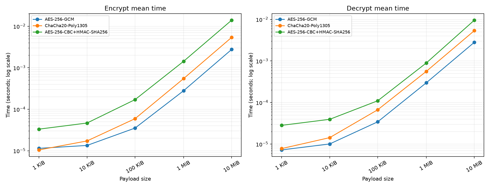
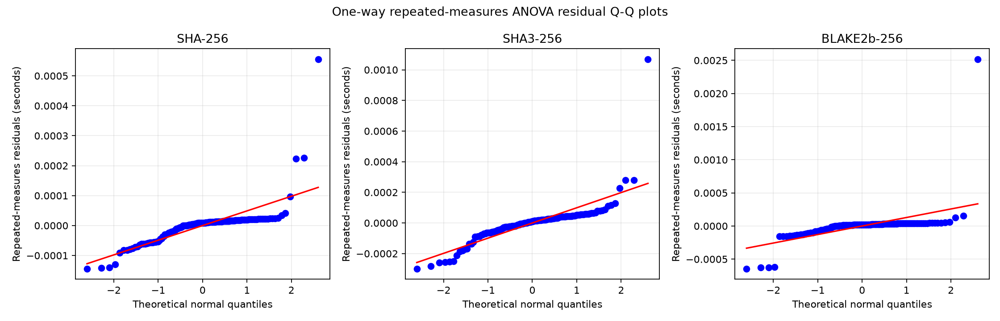

# An Experimental Evaluation of Cryptographic Mechanisms Relevant to Secure IoT Communications Under Adversarial Conditions

**RMIT COSC2539 - Assignment 1: Analytical Security Report**

**Name:** Pham Minh Dat s4139434

**AI-assisted prose:** marked [AI-1]. See “Acknowledgements and AI disclosure” for the required prompt citation and student verification.

# Abstract
This study presents a Python implementation-level evaluation of nine cryptographic constructions relevant to secure IoT communications: three hash functions, three symmetric encryption schemes, and three asymmetric-based hybrid schemes. It examines five payload sizes, functional tampering outcomes, and complete valid and invalid processing paths. Across 2,250 RQ1 observations, repeated-measures analyses indicated input-size effects within each measured series; Mauchly’s tests rejected sphericity, assessed residual diagnostics showed normality departures, and temporal dependence limits inference. RQ2 found that unkeyed digests detect changes only against a trusted reference, while tested Symmetric and Hybrid invalid inputs were rejected without returned plaintext. Holm-adjusted RQ3 contrasts were significant in 0/45 Hashing, 36/75 Symmetric, and 17/60 Hybrid comparisons. These local, single-host findings are conditional and do not establish cross-scheme rankings, deployment performance, or general security guarantees. [AI-1]

# 1. Introduction
Operational technology (OT), industrial Internet of Things (IIoT), and broader IoT systems exchange measurements and commands among sensors, controllers, gateways, and supervisory systems. Cryptographic mechanisms can protect confidentiality and integrity, but their complete processing costs and failure behavior also matter to communication design. The October 11–12, 2026 refrigeration-system cyberattack affecting French supermarkets illustrates the operational consequences of connected-system compromise. Le Monde and the Associated Press reported disruption and food loss across many stores; AP cited an estimate of about 700 affected stores, while Unit 42 stated that the initial access vector was unconfirmed [1]–[3]. Public reports discussed aging equipment and exposed management systems, but did not establish weak cryptography as the cause. This study does not investigate that incident or claim its tested schemes would have prevented it. [AI-1]

The professional context is a hypothetical Cybersecurity Research Engineer role at Nozomi Networks Labs, inspired by the organization’s public OT/IoT focus and Labs’ vulnerability and threat research [4], [5]. This academic role-play does not claim employment, sponsorship, or endorsement. [AI-1]

Prior studies show why performance findings depend on the platform and measured workflow. Silva et al. measured cryptographic delays, power, and message overhead across six embedded boards in a Wi-Fi smart-home setting using HTTP and MQTT [6]. Kietzmann et al. compared software libraries and hardware support on low-end IoT microcontrollers, measuring time, energy, and memory [7]. Bühler et al. measured execution time by input length for symmetric cryptographic algorithms on a 100 MHz Cortex-M4 [8]. Blanc et al. combined primitive-level lightweight AEAD measurements with a Contiki-NG/IoT-LAB application study reporting network and energy metrics [9]. These experiments use embedded hardware or application protocols, unlike the present single-host Python measurements. Research on CBC padding and TLS timing also shows that failure behavior can matter in protocol-specific attacks, but does not establish remote observability of local timings measured here [10], [11]. [AI-1]

This study adds a bounded comparison of digest calls, symmetric authenticated-encryption calls, and asymmetric-based hybrid workflows across 1 KiB–10 MiB, plus functional tampering cases and matched valid/invalid timings. It does not claim novelty as the first cryptographic benchmark. Explicit timing boundaries and randomized blocks document the procedure, although missing Hashing backend metadata, unrecorded Symmetric nonce/IV values, one host, and sequential blocks limit independent recreation and inference [12]. The goal is to inform later device- and protocol-specific evaluation, not to assess a complete IoT security architecture. [AI-1]

The study addresses three questions:

**RQ1:** How does input data size affect the execution time of selected cryptographic algorithms?

**RQ2:** How do selected cryptographic schemes respond to tampered data and invalid ciphertext?

**RQ3:** How do the complete verification and decryption workflows of selected cryptographic constructions differ in execution time when processing valid inputs and specified invalid inputs?

# 2. Experimental Methodology
## 2.1 Schemes and security roles
The Hashing group used SHA-256, SHA3-256, and BLAKE2b-256 (32-byte digest) [13]–[16]. An unkeyed digest detects a change only when compared with a trusted reference; it does not provide confidentiality or authenticate a sender. HMAC uses a shared secret for message authentication, but does not identify which key holder created a valid tag [17]. [AI-1]

The Symmetric group used AES-256-GCM, ChaCha20-Poly1305, and AES-256-CBC with HMAC-SHA256 (CBC-HMAC) [18]–[23]. GCM and ChaCha20-Poly1305 provide authenticated encryption under their key and nonce assumptions; each encryption call generated a fresh 96-bit nonce, though uniqueness cannot be checked from the saved values. CBC-HMAC is Encrypt-then-MAC with separate encryption and MAC keys; it authenticates the IV and ciphertext before CBC decryption and unpadding. A successful shared-key tag does not prove an individual sender’s identity. [AI-1]

The Hybrid group used RSA-OAEP to wrap a fresh AES-256 key, or ECDH P-256/X25519 to establish a shared secret followed by HKDF-SHA256 key derivation; AES-256-GCM encrypted and authenticated each payload [24]–[27]. ECDH and X25519 are key-agreement mechanisms, not standalone public-key encryption. The evaluated schemes used ephemeral sender key material with a long-lived recipient key, but did not add sender authentication or replay protection and did not provide forward secrecy against later compromise of the recipient’s private key. [AI-1]

## 2.2 Data collection and environment
No external dataset was collected. The experiments used 1 KiB, 10 KiB, 100 KiB, 1 MiB, and 10 MiB payloads. Hashing RQ1/RQ3 and Symmetric/Hybrid payloads were seeded pseudo-random buffers; Hashing RQ2 used a repeated byte pattern. Input creation was outside timed regions, and cryptographic keys and nonce/IV values used separate cryptographic randomness. Each RQ1 experiment had 30 complete blocks and five excluded warm-ups, yielding 450 Hashing and 900 observations in each encryption category (2,250 total). Within each block, the runner shuffled the complete set of conditions—algorithm or scheme, size, operation, or scenario as applicable—and measured them sequentially on one Gentoo Linux laptop; blocks were also acquired sequentially. This may reduce order bias but does not establish independence or eliminate temporal effects. Hashing and Hybrid warmed conditions before measured blocks; Symmetric warmed within each block. Schemes within a category shared payload bytes for each block and size. Warm-up schedules therefore differed by category. [AI-1]

The recorded environment was Gentoo Linux, kernel 6.18.60, Intel Core i5-13420H, and CPython 3.14.10. Symmetric/Hybrid metadata recorded OpenSSL 3.6.5 and cryptography 50.0.2; analysis used NumPy 2.5.5, SciPy 1.18.1, and statsmodels 0.15.0 for the Hybrid sensitivity model. Hashing backend version was not recorded. One machine and software environment were evaluated. [AI-1]

## 2.3 Timing boundaries and adversarial cases
All intervals used `time.perf_counter()`. Hashing RQ1 timed digest calculation; Hashing RQ3 also compared against a supplied digest, excluding attacker-side digest recomputation. Symmetric RQ1 timed the complete per-message encryption/decryption call, including nonce/IV generation, encryption, authentication, and relevant validation/unpadding. Hybrid timing included per-message AES-key or ephemeral-key generation, RSA wrapping or key agreement/HKDF, and AES-GCM; long-term recipient key provisioning was excluded. RQ3 timed the complete verification/decryption attempt through the failure stage reached, not isolated authentication overhead. Detailed timing boundaries are in Appendix B. [AI-1]

RQ2 tested trusted and attacker-recomputed digests; valid, tampered, wrong-key, and malformed Symmetric envelopes; and ciphertext/tag/key-material and malformed Hybrid inputs. The attacker-recomputed Hashing case timed verification against a digest already recomputed by the attacker. [AI-1]

# 3. Statistical Analysis
For RQ1, each algorithm or scheme-operation series was analyzed separately with one-factor repeated-measures ANOVA: input size was the five-level within-block factor and block the subject. Mauchly’s tests rejected sphericity for every series; Greenhouse–Geisser corrections adjusted degrees of freedom and p-values. Holm correction was applied across 3 Hashing, 6 Symmetric, and 6 Hybrid omnibus tests at α = .05 [28], [29]. Partial η², calculated as `SS_size / (SS_size + SS_error)`, describes the within-series input-size effect relative to that model’s error; it is not a cross-scheme ranking or measure of deployment benefit. An omnibus result does not identify which sizes differ. [AI-1]

Shapiro–Wilk diagnostics [30] indicated residual-normality departures in the assessed series. Difference-score diagnostics rejected normality for Symmetric and Hybrid; the saved Hashing analysis did not include them. Greenhouse–Geisser does not correct non-normality or temporal dependence. Hashing’s Levene diagnostics rejected equal residual variances for SHA-256 and SHA3-256 but not BLAKE2b-256. Supplementary Friedman rank tests were significant for Hashing and Symmetric; Hybrid had no Friedman test. Their full tables are in Appendix A. [AI-1]

The Hybrid position-adjusted block fixed-effects OLS model is a sensitivity analysis, not conventional repeated-measures ANOVA. It adjusts for randomized condition position and uses CR1 covariance estimates clustered across only 30 blocks; uncertainty should therefore be treated cautiously. The saved output flagged serial/order diagnostics for RSA series and omitted RSA pairwise contrasts under its rule. Full sensitivity-model details are in Appendix A. [AI-1]

For RQ3, comparisons matched each valid condition to a specified scenario within block, construction, and size. The planned families contained 45 Hashing, 75 Symmetric, and 60 Hybrid contrasts; these counts are distinct from 1,350, 2,700, and 2,250 raw timings, respectively. Hashing used sign-flip tests; Symmetric and Hybrid used schedule-conditional label-swap tests, with Holm correction within each family. The valid observations were reused across scenarios, making contrasts correlated. Dependence diagnostics found a Hashing block trend (ρ = .581, p = .00075), a Symmetric maximum within-size lag-1 correlation of .422, and a Hybrid lag-1 correlation (ρ = .426, p = .0213). RQ3 inference remains exploratory/conditional; non-significance does not establish equivalence. [AI-1]

# 4. Results and Discussion
## 4.1 RQ1: Input size and execution time
Means and medians increased from 1 KiB to 10 MiB in all series, with small initial decryption dips for RSA and X25519 Hybrid. The endpoint means below summarize the measured workflows; full medians, per-size comparisons, and diagnostics are in Appendices A and B. [AI-1]

**RQ1 endpoint means and within-series repeated-measures results (slash-separated Symmetric and Hybrid values are encryption/decryption, with encryption first).**

| **Category** | **Mean time at 1 KiB → 10 MiB (ms)** | **Within-series inference** |
| --- | --- | --- |
| Hashing | SHA-256 0.00266 → 4.83394; SHA3-256 0.00363 → 16.37492; BLAKE2b-256 0.00370 → 9.53853 | All 3 significant; Holm p = 1.82×10⁻⁵² to 2.17×10⁻³⁶; partial η² = .996–.9996 |
| Symmetric (encrypt/decrypt) | AES-GCM .01146/.00726 → 2.764/2.816; ChaCha .01049/.00781 → 5.396/5.369; CBC-HMAC .03321/.02830 → 14.012/9.592 | All 6 significant; Holm p = 3.70×10⁻⁴⁹ to 1.93×10⁻²⁷; partial η² = .980–.999 |
| Hybrid (encrypt/decrypt) | RSA .07737/1.57991 → 3.453/4.869; ECDH .14058/.11024 → 3.483/3.506; X25519 .11464/.06793 → 3.403/3.457 | All 6 significant; Holm p = 5.33×10⁻⁴⁰ to 8.33×10⁻²¹; partial η² = .949–.976 |

These ANOVAs test size effects within series, not differences between schemes. Matched descriptive rankings did change with size: Hashing’s SHA3/BLAKE order switched after 1 KiB; AES-GCM moved from a slower mean than ChaCha at 1 KiB to a faster mean from 10 KiB onward; Hybrid encryption rankings also changed, with 10 MiB means close together at 3.403–3.483 ms. No between-scheme significance tests were conducted. [AI-1]

The measured workloads explain why timings should remain category-specific. Hashing processes the data to produce a digest; AEAD schemes encrypt and authenticate payloads; CBC-HMAC performs a separate MAC pass. Hybrid measurements additionally include per-message key wrapping or key agreement and HKDF. Effective throughput is payload size in MiB divided by mean execution time in seconds: Hashing values describe digest-call throughput, while Symmetric and Hybrid values describe complete-call/workflow throughput, not isolated primitive throughput. Full rankings, throughput ranges, matched differences, and plots are in Appendix B. Its Figure B1 shows Hybrid workflow profiles descriptively; it does not establish an inferential cross-scheme ranking. [AI-1]

## 4.2 RQ2: Tampering and invalid-input responses
The functional tests recorded the following outcomes. Hashing RQ2 configurations are separate from its RQ3 timing rows. [AI-1]

**RQ2 functional outcomes.**

| **Category** | **Observed outcomes** |
| --- | --- |
| Hashing | 30 configurations (3 algorithms × 5 sizes × 2 scenarios): 15/15 modified inputs failed against the original trusted digest; 15/15 attacker-recomputed digest checks passed. |
| Symmetric | 90 cases: 15 valid accepted; all 75 invalid rejected with no plaintext returned. Sixty failed at authentication and 15 at envelope validation. |
| Hybrid | 85 cases: 15 valid accepted; all 70 invalid rejected without plaintext returned: 15 ciphertext, 15 tag, and 10 valid replacement-key cases failed at AES-GCM authentication; 5 wrapped-key changes failed OAEP unwrap; 10 malformed public keys failed parsing; 15 malformed common fields failed envelope validation. |

The Hashing outcome demonstrates the trust requirement for an unkeyed digest: it detects the tested change when the reference is trusted, but an attacker replacing both data and digest can compute a matching digest. This is not evidence of weakness in the hash functions. HMAC can authenticate a message under a shared secret, but parties sharing that key are not individually identified [17]. [AI-1]

AES-GCM and ChaCha20-Poly1305 rejected the tested unauthenticated ciphertext; a valid shared-key tag does not identify a sender. CBC-HMAC authenticated the IV and ciphertext before CBC decryption and unpadding, so the tested tampering failed at MAC verification. Hybrid schemes used RSA-OAEP for key wrapping or ECDH/X25519 plus HKDF for key derivation, with AES-GCM protecting the payload. Authentication success does not establish sender identity, and the test matrix is not a proof of general security. The tested invalid Symmetric and Hybrid calls returned no plaintext; this is implementation-specific functional evidence. The observed CBC-HMAC ordering is relevant to padding-oracle risk, but does not establish resistance to every side channel or protocol attack [10]. [AI-1]

## 4.3 RQ3: Valid and invalid processing times
Holm-adjusted paired results were significant in 0/45 Hashing, 36/75 Symmetric, and 17/60 Hybrid contrasts. Hashing’s block trend (ρ = .581, p = .00075), Symmetric maximum within-size lag-1 correlation (.422), and Hybrid lag-1 correlation (ρ = .426, p = .0213), together with the design-conditional tests, limit inference. Symmetric used the corrected raw run `run_20261119_02`; detailed comparison-family definitions are in Appendix C. [AI-1]

The measured construct is complete processing-path time. Malformed inputs may stop at parsing, while ciphertext/tag changes can reach authenticated decryption; CBC-HMAC stops after MAC failure, RSA wrapped-key changes at OAEP unwrap, and ECDH/X25519 paths can proceed through agreement and HKDF before GCM rejects. At 1 KiB, AES-GCM ciphertext tampering averaged +0.003705 ms paired difference (+117.84%), while malformed-envelope rejection averaged −0.002574 ms (−37.36%); both existing adjusted p-values were .0205. These opposite directions show that invalid inputs do not share a single timing pattern. The percentages use short baselines and should be read beside absolute differences. [AI-1]

At 10 MiB, CBC-HMAC ciphertext tampering averaged 5.592 ms versus 9.463 ms valid (mean paired difference −3.871 ms; adjusted p = .0075), consistent with MAC rejection before CBC decryption. RSA malformed-envelope rejection at 1 KiB was 12.92 µs versus 1.511 ms valid (adjusted p = 1.1176×10⁻⁷). Other contrasts were not significant; that does not establish equal processing times. Full magnitude summaries and the corrected-run Symmetric figure (Figure C1) are in Appendix C. These local complete-path timings do not isolate authentication overhead or demonstrate a remotely exploitable side channel; faster rejection is not stronger security. [AI-1]

# 5. Limitations
The measurements used one Gentoo host, seeded pseudo-random payloads, and different category warm-up schedules; they do not characterize deployed IoT hardware, network latency, memory, energy, or application workloads. Sequential blocks and observed temporal dependence limit inferential claims. Sphericity corrections do not resolve normality or dependence violations, and the Hybrid CR1 model has only 30 clusters. Hashing backend version is absent from metadata. Symmetric nonce/IV values were not persisted, so per-key uniqueness could not be independently checked, although fresh cryptographic randomness was confirmed in source; collision risk is low, not zero. No formal security proof, sender authentication, replay protection, or general side-channel assessment was performed. [AI-1]

# 6. Conclusion
Across the tested implementations, larger payloads generally required more processing time, with within-series ANOVA indicating input-size effects subject to assumption and dependence limitations. Functional tests showed that trusted digests detect tested changes, authenticated encryption and CBC-HMAC reject tested invalid messages, and hybrid key handling does not itself authenticate senders. RQ3 differences depended on the failure stage and remain exploratory/conditional. The study contributes bounded Python workflow evidence to inform later IoT/IIoT device and protocol testing; it does not rank universal deployment choices or provide a complete security solution. Future work should measure target hardware, energy and network behavior, and protocol-level sender authentication and replay protections. [AI-1]

# References
Bibliographic entries were compiled with AI assistance. [AI-1] The student must complete the prompt citation and verify every bibliographic entry against its source before submission.

[1] I. Chaperon, D. Leloup, O. Pinaud, M. Rescan, and F. Reynaud, “A disastrous day for French supermarkets after massive cyberattack targets refrigeration systems,” *Le Monde*, Oct. 13, 2026. [Online]. Available: https://www.lemonde.fr/en/economy/article/2026/10/13/a-disastrous-day-for-french-supermarkets-after-massive-cyberattack-targets-refrigeration-systems_6758535_19.html. [Accessed: Nov. 20, 2026].

[2] A. Charlton and D.-A. Durbin, “Cyberattacks hit European supermarket chains and disrupt refrigeration systems,” *Associated Press*, Oct. 13, 2026. [Online]. Available: https://apnews.com/article/78a813a8efd466b360655339f96083dc. [Accessed: Nov. 20, 2026].

[3] Unit 42, “Turning Up the Heat: Inside the Attacks on Europe’s Refrigeration Systems,” *Palo Alto Networks*, Nov. 6, 2026. [Online]. Available: https://origin-unit42.paloaltonetworks.com/europes-refrigeration-systems-attacks/. [Accessed: Nov. 20, 2026].

[4] Nozomi Networks, “About Us,” n.d. [Online]. Available: https://www.nozominetworks.com/company. [Accessed: Nov. 20, 2026].

[5] Nozomi Networks Labs, “Nozomi Networks Labs,” n.d. [Online]. Available: https://www.nozominetworks.com/labs. [Accessed: Nov. 20, 2026].

[6] C. Silva, V. A. Cunha, J. P. Barraca, and R. L. Aguiar, “Analysis of the cryptographic algorithms in IoT communications,” *Information Systems Frontiers*, vol. 26, pp. 1243–1260, 2024, doi: 10.1007/s10796-023-10383-9.

[7] P. Kietzmann, L. Boeckmann, L. Lanzieri, T. C. Schmidt, and M. Wählisch, “A performance study of crypto-hardware in the low-end IoT,” in *Proc. 18th Int. Conf. Embedded Wireless Syst. Netw. (EWSN ’21)*, 2021, pp. 79–90, doi: 10.5555/3451271.3451279. [Online]. Available: https://dl.acm.org/doi/10.5555/3451271.3451279

[8] H. Bühler, A. Walz, and A. Sikora, “Benchmarking of symmetric cryptographic algorithms on a deeply embedded system,” *IFAC-PapersOnLine*, vol. 55, no. 4, pp. 266–271, 2022, doi: 10.1016/j.ifacol.2022.06.044.

[9] S. Blanc, A. Lahmadi, K. Le Gouguec, M. Minier, and L. Sleem, “Benchmarking of lightweight cryptographic algorithms for wireless IoT networks,” *Wireless Networks*, vol. 28, no. 8, pp. 3453–3476, 2022, doi: 10.1007/s11276-022-03046-1.

[10] S. Vaudenay, “Security flaws induced by CBC padding—applications to SSL, IPSEC, WTLS, ...,” in *Advances in Cryptology—EUROCRYPT 2002*, Lecture Notes in Computer Science, vol. 2332. Berlin, Germany: Springer, 2002, pp. 534–545, doi: 10.1007/3-540-46035-7_35.

[11] N. J. AlFardan and K. G. Paterson, “Lucky Thirteen: Breaking the TLS and DTLS record protocols,” in *Proc. 2013 IEEE Symp. Security and Privacy*, 2013, pp. 526–540, doi: 10.1109/SP.2013.42.

[12] T. Kalibera and R. E. Jones, “Rigorous benchmarking in reasonable time,” in *Proc. ACM SIGPLAN Int. Symp. Memory Management (ISMM)*, 2013, pp. 63–74, doi: 10.1145/2464157.2464160.

[13] National Institute of Standards and Technology, *Secure Hash Standard (SHS)*, FIPS PUB 180-4, Aug. 2015. [Online]. Available: https://csrc.nist.gov/pubs/fips/180-4/upd1/final

[14] National Institute of Standards and Technology, *SHA-3 Standard: Permutation-Based Hash and Extendable-Output Functions*, FIPS PUB 202, Aug. 2015. [Online]. Available: https://csrc.nist.gov/pubs/fips/202/final

[15] M.-J. O. Saarinen and J.-P. Aumasson, “The BLAKE2 cryptographic hash and message authentication code (MAC),” RFC 7693, Nov. 2015. [Online]. Available: https://www.rfc-editor.org/rfc/rfc7693

[16] J.-P. Aumasson, S. Neves, Z. Wilcox-O’Hearn, and C. Winnerlein, “BLAKE2: Simpler, smaller, fast as MD5,” in *Applied Cryptography and Network Security*, Lecture Notes in Computer Science, vol. 7954, 2013, pp. 119–135, doi: 10.1007/978-3-642-38980-1_8.

[17] H. Krawczyk, M. Bellare, and R. Canetti, “HMAC: Keyed-hashing for message authentication,” RFC 2104, Feb. 1997. [Online]. Available: https://www.rfc-editor.org/rfc/rfc2104

[18] National Institute of Standards and Technology, *Advanced Encryption Standard (AES)*, FIPS PUB 197, updated May 2023. [Online]. Available: https://csrc.nist.gov/pubs/fips/197/final

[19] M. Dworkin, *Recommendation for Block Cipher Modes of Operation: Galois/Counter Mode (GCM) and GMAC*, NIST SP 800-38D, Nov. 2007. [Online]. Available: https://csrc.nist.gov/pubs/sp/800/38/d/final

[20] Y. Nir and A. Langley, “ChaCha20 and Poly1305 for IETF protocols,” RFC 8439, June 2018. [Online]. Available: https://www.rfc-editor.org/rfc/rfc8439

[21] Python Cryptographic Authority, *cryptography 50.0.2 documentation*, 2026. [Online]. Available: https://cryptography.io/en/50.0.2/

[22] D. McGrew, “An interface and algorithms for authenticated encryption,” RFC 5116, Jan. 2008, doi: 10.17487/RFC5116. [Online]. Available: https://www.rfc-editor.org/rfc/rfc5116

[23] M. Dworkin, *Recommendation for Block Cipher Modes of Operation: Methods and Techniques*, NIST SP 800-38A, Dec. 2001. [Online]. Available: https://csrc.nist.gov/pubs/sp/800/38/a/final

[24] K. Moriarty, B. Kaliski, J. Jonsson, and A. Rusch, “PKCS #1: RSA Cryptography Specifications Version 2.2,” RFC 8017, Nov. 2016. [Online]. Available: https://www.rfc-editor.org/rfc/rfc8017

[25] A. Langley, M. Hamburg, and S. Turner, “Elliptic curves for security,” RFC 7748, Jan. 2016. [Online]. Available: https://www.rfc-editor.org/rfc/rfc7748

[26] H. Krawczyk and P. Eronen, “HMAC-based extract-and-expand key derivation function (HKDF),” RFC 5869, May 2010. [Online]. Available: https://www.rfc-editor.org/rfc/rfc5869

[27] E. Barker, L. Chen, A. Roginsky, A. Vassilev, and R. Davis, *Recommendation for Pair-Wise Key-Establishment Schemes Using Discrete Logarithm Cryptography*, NIST SP 800-56A Rev. 3, Apr. 2018. [Online]. Available: https://csrc.nist.gov/pubs/sp/800/56/a/r3/final

[28] S. W. Greenhouse and S. Geisser, “On methods in the analysis of profile data,” *Psychometrika*, vol. 24, no. 2, pp. 95–112, 1959, doi: 10.1007/BF02289823.

[29] S. Holm, “A simple sequentially rejective multiple test procedure,” *Scandinavian Journal of Statistics*, vol. 6, no. 2, pp. 65–70, 1979, doi: 10.2307/4615733.

[30] S. S. Shapiro and M. B. Wilk, “An analysis of variance test for normality (complete samples),” *Biometrika*, vol. 52, nos. 3–4, pp. 591–611, 1965, doi: 10.1093/biomet/52.3-4.591.

[31] M. Friedman, “The use of ranks to avoid the assumption of normality implicit in the analysis of variance,” *Journal of the American Statistical Association*, vol. 32, no. 200, pp. 675–701, 1937, doi: 10.1080/01621459.1937.10503522.

# Acknowledgements and AI disclosure
**Acknowledgements:** [Student: acknowledge assistance/funding, or state that there was none.]

**AI use:** AI assistance was used to summarize project evidence, organize sections, and draft text; it did not generate experiment observations. [AI-1] marks AI-assisted prose that the student must check and revise.

[AI-1] "[TODO: insert the exact prompt text used to request or edit this report, verbatim]." ChatGPT, [TODO: model/version], OpenAI, [TODO: Day Month Year], chat.openai.com.

[TODO: Add a separate citation in the required format for each additional prompt used to generate or revise report text.]

```{=openxml}
<w:p><w:r><w:br w:type="page"/></w:r></w:p>
```

# Appendix A. Full RQ1 repeated-measures results
The following values are transcribed from the authoritative repeated-measures ANOVA outputs. Adjusted p-values are Holm-corrected within each category. For compact row labels, AES-GCM means AES-256-GCM, ChaCha means ChaCha20-Poly1305, and CBC-HMAC means AES-256-CBC with HMAC-SHA256; RSA, ECDH, and X25519 refer to the complete asymmetric-based hybrid schemes defined in Section 2.1. The analysis CSVs are: `results/hashing/rq1/randomized_block/repeated_measures/hashing_repeated_measures_anova.csv`; `results/symmetric/rq1/analysis/run_20261119_02/symmetric_rq1_repeated_measures_anova.csv`; and `results/asymmetric/rq1/analysis/run_20261119_01/asymmetric_rq1_repeated_measures_anova.csv`. [AI-1]

**Full RQ1 repeated-measures ANOVA results.**

| **Category / operation** | **F** | **GG df (numerator, denominator)** | **Holm-adjusted p** | **Partial η²** |
| --- | --- | --- | --- | --- |
| Hash SHA-256 | 24904.48 | 1.014, 29.408 | 2.15×10⁻⁴⁴ | .99884 |
| Hash SHA3-256 | 78241.53 | 1.033, 29.966 | 1.82×10⁻⁵² | .99963 |
| Hash BLAKE2b-256 | 7197.35 | 1.002, 29.070 | 2.17×10⁻³⁶ | .99599 |
| AES-GCM encrypt | 2240.42 | 1.068, 30.983 | 1.56×10⁻³⁰ | .98722 |
| AES-GCM decrypt | 1395.97 | 1.057, 30.661 | 1.93×10⁻²⁷ | .97965 |
| ChaCha encrypt | 3806.93 | 1.071, 31.057 | 5.74×10⁻³⁴ | .99244 |
| ChaCha decrypt | 7446.18 | 1.063, 30.830 | 5.60×10⁻³⁸ | .99612 |
| CBC-HMAC encrypt | 26684.14 | 1.128, 32.708 | 3.70×10⁻⁴⁹ | .99891 |
| CBC-HMAC decrypt | 5686.97 | 1.027, 29.770 | 4.31×10⁻³⁵ | .99493 |
| RSA hybrid encrypt | 644.63 | 1.043, 30.260 | 1.39×10⁻²¹ | .957 |
| RSA hybrid decrypt | 1192.94 | 1.689, 48.980 | 5.33×10⁻⁴⁰ | .976 |
| ECDH hybrid encrypt | 556.36 | 1.035, 30.015 | 8.33×10⁻²¹ | .950 |
| ECDH hybrid decrypt | 671.17 | 1.059, 30.717 | 4.83×10⁻²² | .959 |
| X25519 hybrid encrypt | 542.94 | 1.037, 30.068 | 8.33×10⁻²¹ | .949 |
| X25519 hybrid decrypt | 631.29 | 1.046, 30.335 | 1.39×10⁻²¹ | .956 |

Hashing and Symmetric also report Friedman repeated-block rank tests, separately from their ANOVA families [31]. Hashing's Friedman p-values were Holm-adjusted across three algorithms (a separate family from the three ANOVA tests):

**Hashing Friedman repeated-block results.**

| Algorithm | χ²(4) | Raw p | Holm-adjusted p |
| --- | ---: | ---: | ---: |
| SHA-256 | 119.227 | 7.81×10⁻²⁵ | 1.60×10⁻²⁴ |
| SHA3-256 | 120.000 | 5.34×10⁻²⁵ | 1.60×10⁻²⁴ |
| BLAKE2b-256 | 120.000 | 5.34×10⁻²⁵ | 1.60×10⁻²⁴ |

Symmetric Friedman p-values were Holm-adjusted across six scheme-operation tests (separate from the six ANOVA tests):

**Symmetric Friedman repeated-block results.**

| Scheme-operation | χ²(4) | Raw p | Holm-adjusted p |
| --- | ---: | ---: | ---: |
| AES-GCM encrypt | 112.827 | 1.82×10⁻²³ | 1.91×10⁻²³ |
| AES-GCM decrypt | 116.667 | 2.75×10⁻²⁴ | 1.38×10⁻²³ |
| ChaCha encrypt | 117.227 | 2.09×10⁻²⁴ | 1.25×10⁻²³ |
| ChaCha decrypt | 116.160 | 3.53×10⁻²⁴ | 1.41×10⁻²³ |
| CBC-HMAC encrypt | 114.960 | 6.36×10⁻²⁴ | 1.91×10⁻²³ |
| CBC-HMAC decrypt | 114.427 | 8.27×10⁻²⁴ | 1.91×10⁻²³ |

These rank tests concern within-block input-size ranks, not arithmetic means; their adjusted results are supplementary and do not replace or duplicate the ANOVA inference. Hybrid has no implemented or reported Friedman test; this is a difference in implemented analyses, not an unreported result.

## Hybrid OLS sensitivity analysis

Hybrid's complementary sensitivity model is OLS of execution time in seconds on input-size indicators, block fixed effects, and centered randomized condition position, fitted separately for each scheme-operation. The joint Wald F test concerns the input-size coefficients, conditional on block and linear position. Block fixed effects absorb block-level mean differences; CR1 cluster-robust covariance clustered by block is intended to allow within-block error dependence and heteroskedasticity when estimating uncertainty. The analysis uses only 30 blocks (clusters), so its cluster-robust uncertainty estimates should be interpreted cautiously given the relatively limited cluster count. It is a position-adjusted sensitivity analysis, not a replacement for the primary repeated-measures ANOVA: it uses a different model and approximate cluster-based inference, and does not remove the limitations from sequential blocks or prove independence.

All six OLS omnibus tests remained significant after Holm correction across six scheme-operation tests; RSA encryption/decryption Wald F values were 213.32/459.14, ECDH 113.51/185.78, and X25519 204.95/310.55. The saved model output flags RSA encryption for block_order_trend and RSA decryption for serial_dependence_between_blocks; the implementation omits pairwise OLS contrasts whenever a diagnostic flag is present. Thus RSA contrasts were omitted under that rule, and the saved evidence does not establish a broader statistical justification beyond those flagged diagnostics.

## RQ1 assumption diagnostics

Residual normality was assessed with Shapiro-Wilk [30], with departures indicated in the assessed RQ1 series. Difference-score Shapiro-Wilk diagnostics rejected normality for Symmetric and Hybrid; the saved Hashing RM-ANOVA did not include difference-score normality diagnostics. Greenhouse-Geisser adjusts degrees of freedom and p-values for sphericity only; it does not correct non-normality or temporal dependence. Symmetric RQ1's maximum within-size lag-1 correlation was .517, indicating possible temporal dependence.

For Hashing, the saved repeated-measures output reports a median-centered Levene test on model residuals grouped by input size: equal residual variances were rejected for SHA-256 (p = .00416) and SHA3-256 (p = 3.71×10⁻⁵), but were not rejected for BLAKE2b-256 (p = .403). This is a supplementary variance diagnostic, not a test of sphericity; Mauchly's test assesses sphericity. [AI-1]

# Appendix B. Extended RQ1 results and supporting material

The following material provides the full endpoint summaries, matched descriptive comparisons, throughput rankings, timing boundaries, and diagnostics supporting Section 4.1. [AI-1]


*Figure B1. Hybrid workflow means by size and operation. The plot compares descriptive profiles, not statistically tested cross-scheme rankings.*

**Timing boundaries for RQ1 and RQ3 by category.**

| **Category** | **RQ1 timing** | **RQ3 timing** |
| --- | --- | --- |
| Hashing | Digest call; hex formatting excluded. | Digest calculation plus comparison with a supplied digest. Attacker-side digest recomputation excluded. |
| Symmetric | Full per-message encrypt/decrypt call. Encryption includes nonce/IV generation, padding, encryption, and tag/MAC creation; decryption includes validation, authentication, decryption, and unpadding where reached. | Complete decrypt attempt, including early parsing/validation and the failure path. Authentication cost is not isolated. |
| Hybrid | RSA encryption: per-message AES session-key generation, AES-GCM, and OAEP wrapping. ECDH/X25519 encryption: per-message ephemeral sender-key generation, key agreement, HKDF, and AES-GCM. Decryption: RSA-OAEP unwrap or ECDH/X25519 agreement and HKDF, then AES-GCM. Long-term recipient keypair generation/provisioning is outside the timer. | Complete decrypt attempt through parsing, key recovery/agreement, HKDF, and AES-GCM stages reached. |

**RQ1 endpoint timing summaries and repeated-measures results.**

| **Category** | **1 KiB mean (median) → 10 MiB mean (median), ms** | **Repeated-measures result** |
| --- | --- | --- |
| Hashing | SHA-256 0.00266 (0.00217) → 4.83394 (4.78296); SHA3-256 0.00363 (0.00350) → 16.37492 (16.30209); BLAKE2b-256 0.00370 (0.00281) → 9.53853 (9.41434) | All 3 significant; Holm p = 1.82×10⁻⁵² to 2.17×10⁻³⁶; partial η² = .996–.9996 |
| Symmetric (encrypt/decrypt pairs) | AES-GCM .01146/.00726 (.00910/.00616) → 2.764/2.816 (2.638/2.641); ChaCha20-Poly1305 .01049/.00781 (.00832/.00619) → 5.396/5.369 (5.164/5.228); CBC-HMAC .03321/.02830 (.03701/.02839) → 14.012/9.592 (13.943/9.217) | All 6 significant; Holm p = 3.70×10⁻⁴⁹ to 1.93×10⁻²⁷; partial η² = .980–.999 |
| Hybrid (encrypt/decrypt pairs) | RSA .07737/1.57991 (.06942/1.53884) → 3.453/4.869 (3.26790/4.86074); ECDH .14058/.11024 (.13640/.11009) → 3.483/3.506 (3.23826/3.24504); X25519 .11464/.06793 (.10868/.06474) → 3.403/3.457 (3.24308/3.28852) | All 6 significant; Holm p = 5.33×10⁻⁴⁰ to 8.33×10⁻²¹; partial η² = .949–.976 |
For Symmetric and Hybrid rows, each paired value is encryption/decryption (encryption first); means are outside parentheses and medians are inside. The category analysis CSVs contain all five sizes and other descriptive statistics, while Appendix A gives the full repeated-measures ANOVA results. [AI-1]

### Matched descriptive comparisons within categories

The comparisons match Hashing by `(block, input size, algorithm)` and Symmetric/Hybrid by `(block, input size, operation, algorithm or scheme)`, giving 30 block pairs per contrast. Schemes shared the same payload within a block and size, and input identifiers were checked. Condition summaries include mean, median, sample standard deviation, and effective throughput; pairwise outputs include matched `A − B` differences, blockwise `A/B` ratios, and percentages `100 × (A − B) / B`. The outputs contain 15 Hashing, 30 Symmetric, and 30 Hybrid descriptive contrasts; no between-algorithm significance tests were conducted. At 1 KiB, relative measures are sensitive to microsecond-scale variation and should be read with absolute differences and standard deviations. Full estimates are in [`rq1_matched_descriptive.csv`](../../results/rq1_matched_comparisons/rq1_matched_descriptive.csv) and [`rq1_matched_pairwise.csv`](../../results/rq1_matched_comparisons/rq1_matched_pairwise.csv); validation and source-file checksums are in [`rq1_matched_validation.json`](../../results/rq1_matched_comparisons/rq1_matched_validation.json). [AI-1]

In the ranking summary below, each sequence is ordered from lower to higher observed time; the abbreviations are defined in the column labels. Size intervals indicate that the same order held at each size in that interval. Throughput is calculated as `(payload bytes / 1,048,576) / mean execution time in seconds`. Hashing values therefore describe digest-call throughput, while Symmetric and Hybrid values represent effective complete-call or complete-workflow throughput rather than primitive-only throughput. Because categories use different timed operations and warm-up schedules, their throughput ranges are contextual within each category and should not be used as a cross-category performance ranking.

**RQ1 matched descriptive rankings and effective throughput ranges.**

| **Series** | **Mean-time ranking across sizes** | **Median-time ranking across sizes** | **Effective throughput range across tested sizes (MiB/s)** |
| --- | --- | --- | --- |
| Hashing digest (SHA = SHA-256; SHA3 = SHA3-256; BLAKE = BLAKE2b-256) | 1 KiB: SHA < SHA3 < BLAKE; 10 KiB–10 MiB: SHA < BLAKE < SHA3 | All sizes: SHA < BLAKE < SHA3 | SHA 367–2,080; BLAKE 264–1,048; SHA3 269–617 |
| Symmetric encryption (AES = AES-256-GCM; ChaCha = ChaCha20-Poly1305; CBC = AES-256-CBC + HMAC-SHA256) | 1 KiB: ChaCha < AES < CBC; 10 KiB–10 MiB: AES < ChaCha < CBC | Same ordering as means at each size | AES 85–3,617; ChaCha 93–1,853; CBC 29–714 |
| Symmetric decryption (same labels) | All sizes: AES < ChaCha < CBC | All sizes: AES < ChaCha < CBC | AES 135–3,551; ChaCha 125–1,863; CBC 35–1,117 |
| Hybrid encryption (RSA = RSA-OAEP + AES-GCM; ECDH = ECDH P-256 + HKDF + AES-GCM; X25519 = X25519 + HKDF + AES-GCM) | 1 KiB–100 KiB: RSA < X25519 < ECDH; 1 MiB: RSA < ECDH < X25519; 10 MiB: X25519 < RSA < ECDH | 1 KiB–100 KiB: RSA < X25519 < ECDH; 1 MiB: RSA < ECDH < X25519; 10 MiB: ECDH < X25519 < RSA | RSA 12.6–2,896; ECDH 6.9–2,871; X25519 8.5–2,939 |
| Hybrid decryption (same labels) | All sizes: X25519 < ECDH < RSA | 1 KiB–1 MiB: X25519 < ECDH < RSA; 10 MiB: ECDH < X25519 < RSA | RSA 0.62–2,054; ECDH 8.9–2,853; X25519 14.4–2,893 |

The paired outputs quantify descriptive gaps without establishing between-scheme significance. At 10 KiB, SHA-256 versus BLAKE2b-256 had a mean paired difference of −0.004906 ms, a mean ratio of 0.594, and a mean percentage difference of −40.61%; at 10 MiB, SHA-256 versus SHA3-256 had corresponding values of −11.541 ms, 0.295, and −70.47%. At 10 MiB, AES-GCM versus ChaCha encryption had a mean paired difference of −2.632 ms (ratio 0.516; percentage −48.41%). Hybrid encryption at 10 MiB illustrates sensitivity to the summary statistic: X25519 had the lowest mean and ECDH the lowest median, while the RSA-versus-X25519 mean and median paired differences were +0.0502 and −0.00117 ms. These observed rank changes are descriptive, not statistically tested crossovers. [AI-1]

Figure B2 presents Symmetric complete-call profiles by size and operation. CBC-HMAC's separate HMAC pass is consistent with its higher large-payload means, but the experiment did not isolate the pass's contribution.

Figure B1 shows descriptive Hybrid workflow means. Because each timed workflow includes per-message key processing and AES-GCM payload processing, these results do not isolate either component's contribution to the observed size-dependent rankings.



*Figure B2. Mean execution time by payload size and operation for AES-256-GCM, ChaCha20-Poly1305, and AES-256-CBC with HMAC-SHA256 (CBC-HMAC). Time is shown on a logarithmic scale; the plot is descriptive, and no between-scheme test was conducted.*



*Figure B3. Hashing residual Q-Q diagnostics. Shown as an assumption diagnostic, not a performance plot.*

Figure B3 provides the Hashing residual diagnostic referenced in Section 3 and Appendix A.

# Appendix C. Extended RQ3 magnitude results

The following matched contrasts and interpretation support Section 4.3. [AI-1]

## RQ3 paired-test details

One paired comparison is a planned contrast for a fixed algorithm or scheme and size, matched over 30 blocks. Hashing has three contrasts per algorithm-size configuration (trusted-digest tampering versus valid, attacker-recomputed digest versus valid, and trusted-digest tampering versus attacker-recomputed digest), giving 3 algorithms × 5 sizes × 3 contrasts = 45. Symmetric has five invalid-versus-valid contrasts per algorithm-size configuration, giving 3 × 5 × 5 = 75; Hybrid has four per scheme-size configuration, giving 3 × 5 × 4 = 60. These are paired-comparison rows, not raw timing observations; the corresponding raw datasets contain 1,350 Hashing, 2,700 Symmetric, and 2,250 Hybrid timings. Holm correction covers all comparison rows in each category family at α = .05.

Hashing's sign-flip test depends on sign exchangeability/symmetry and is not an exact design-based test of condition assignment. Symmetric and Hybrid label-swap tests are conditional on their generated schedules and a sharp no-effect null. All require caution about finite-state PRNG assignment and no consequential carry-over. Diagnostics showed temporal structure: a Hashing block trend, maximum within-size lag-1 correlation 0.422 for Symmetric RQ3, and Hybrid block lag-1 correlation 0.426 (p = .0213). These diagnostics warrant treating RQ3 inference as exploratory or conditional. A non-significant test does not establish equivalence. [AI-1]

Aggregate-mean percentage differences are calculated as `100 × (compared-condition mean − valid-condition mean) / valid-condition mean`. The RQ3 magnitude table's `Mean paired Δ (%)` instead averages the 30 block-level percentages. These summaries can differ because a percentage calculated from condition means is not generally equal to the mean of block-level percentages.

The RQ3 magnitude table gives selected examples across small and large payloads and distinct failure stages. Each row contrasts a construction with its own matched valid path; the table is not a cross-category performance ranking. The full set of 165 descriptive valid-versus-specified-invalid/adversarial contrasts is in `results/rq3_timing_magnitude_analysis_run_20261121_01/rq3_valid_invalid_timing_magnitude.csv`; its row, match, outcome, and checksum validation is in the adjacent `rq3_valid_invalid_timing_validation.json`.

**Selected RQ3 matched valid-versus-compared-path timing magnitudes.**

| **Category, construction and comparison path** | **Size** | **Valid mean [median] (µs)** | **Compared-path mean [median] (µs)** | **Mean paired Δ (µs)** | **Mean paired Δ (%)** | **Existing Holm-adjusted p** |
| --- | ---: | ---: | ---: | ---: | ---: | ---: |
| Hashing, SHA-256; modified input vs trusted digest (digest mismatch) | 10 MiB | 4,906.12 [4,870.32] | 4,810.04 [4,759.73] | −96.08 | −1.83 | 1.0000 |
| Hashing, SHA3-256; modified input vs attacker-recomputed digest (verification passes) | 10 MiB | 17,077.66 [17,338.39] | 17,181.78 [17,582.85] | +104.11 | +0.62 | 1.0000 |
| Symmetric, AES-256-GCM; ciphertext tampering (authentication failure) | 1 KiB | 5.02 [3.49] | 8.73 [8.51] | +3.71 | +117.84 | 0.0205 |
| Symmetric, AES-256-GCM; malformed envelope (envelope validation) | 10 MiB | 2,747.85 [2,633.82] | 1.97 [1.95] | −2,745.88 | −99.93 | 0.0075 |
| Symmetric, ChaCha20-Poly1305; ciphertext tampering (authentication failure) | 10 MiB | 5,315.08 [5,187.88] | 5,444.26 [5,220.33] | +129.18 | +2.87 | 1.0000 |
| Symmetric, CBC-HMAC; ciphertext tampering (MAC failure before CBC decryption) | 10 MiB | 9,462.98 [9,197.89] | 5,591.91 [5,529.09] | −3,871.07 | −40.70 | 0.0075 |
| Hybrid, RSA-OAEP + AES-GCM; malformed envelope (envelope validation) | 1 KiB | 1,510.67 [1,484.86] | 12.92 [5.15] | −1,497.75 | −99.15 | 1.1176×10⁻⁷ |
| Hybrid, RSA-OAEP + AES-GCM; wrapped-key tampering (OAEP unwrap failure) | 10 MiB | 4,727.58 [4,457.71] | 1,474.48 [1,466.61] | −3,253.11 | −68.10 | 1.1176×10⁻⁷ |
| Hybrid, ECDH P-256 + HKDF + AES-GCM; replacement public key (agreement and HKDF, then GCM failure) | 10 MiB | 3,115.81 [2,958.75] | 3,384.20 [3,047.14] | +268.39 | +10.47 | 1.0000 |
| Hybrid, X25519 + HKDF + AES-GCM; ciphertext tampering (agreement, HKDF, then GCM failure) | 10 MiB | 3,225.62 [3,012.74] | 3,419.58 [2,989.15] | +193.97 | +8.26 | 1.0000 |

Each mean/median pair summarizes 30 matched observations. Mean paired Δ is the average block-matched `compared time − valid time`; mean paired Δ (%) is the arithmetic mean of the 30 block-level percentages. This paired percentage can differ in direction from the aggregate-mean percentage defined above.

For SHA-256 at 1 KiB, valid and invalid means were 0.002071 and 0.002003 ms, while mean paired Δ was −0.0000687 ms, mean paired Δ (%) was +54.35%, and the ratio of aggregate means was 0.967. With short valid baselines, relative changes are sensitive to small fluctuations and should be interpreted alongside absolute differences and timing distributions. Adjusted p-values come from existing paired-test outputs; no tests were added. Hashing's adjustments use its full 45-comparison family, of which the magnitude CSV shows only 30 valid-baseline contrasts; the other 15 compare its two modified-data scenarios. [AI-1]

Each construction's valid observations are reused across scenario contrasts, so those comparisons are correlated; Holm correction does not make them independent. RQ3 inference remains exploratory or conditional given the assignment assumptions and temporal diagnostics above. Non-significance does not establish equivalence, faster rejection does not imply stronger security, and these local timings do not demonstrate a remotely exploitable side channel. [AI-1]


*Figure C1. Symmetric corrected-run RQ3 times by failure scenario and payload size; raw data are from run_20261119_02.*
