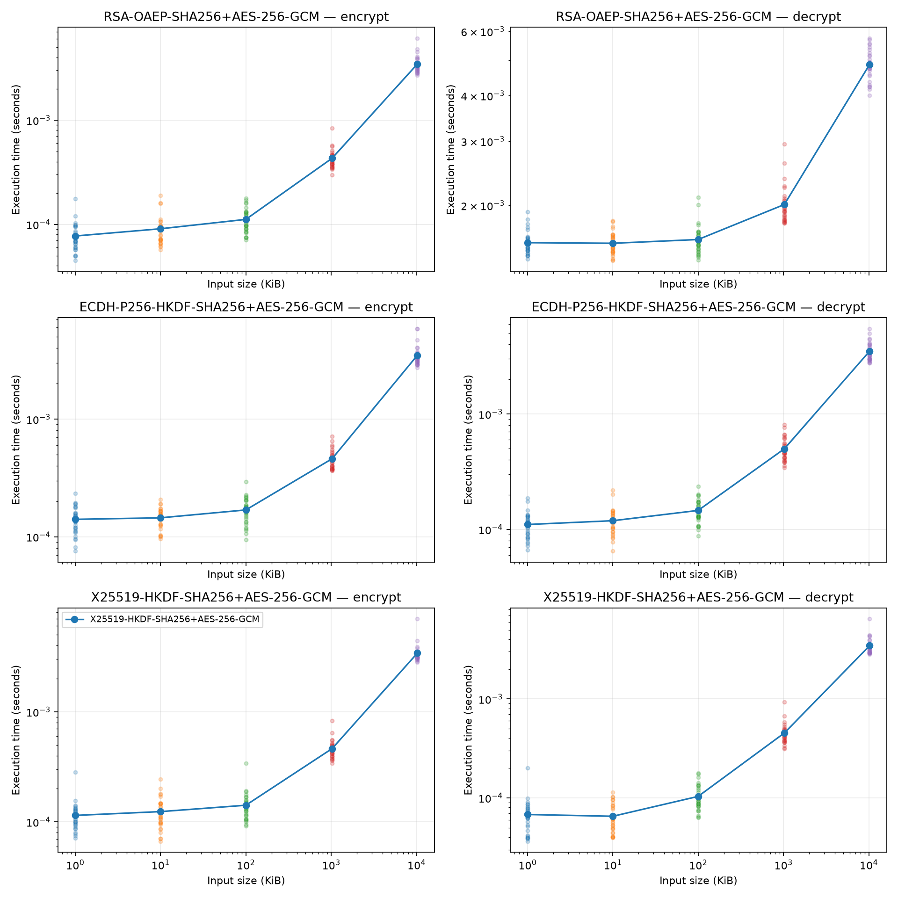

An Experimental Evaluation of Cryptographic Mechanisms Relevant to Secure IoT Communications Under Adversarial Conditions

**RMIT COSC2539 - Assignment 1: Analytical Security Report**

**Name:** Pham Minh Dat s4139434

**AI-assisted prose:** marked [AI-1]. See “Acknowledgements and AI disclosure” for the required prompt citation and student verification.
# Abstract
Motivated by a hypothetical Cybersecurity Research Engineer role-play inspired by Nozomi Networks Labs' public OT/IoT research domain, this study presents an implementation-level evaluation of nine cryptographic constructions across five payload sizes. It measures SHA-256, SHA3-256, and BLAKE2b-256; AES-256-GCM, ChaCha20-Poly1305, and AES-256-CBC with HMAC-SHA256; and three asymmetric-based hybrid schemes using RSA-OAEP, ECDH P-256, or X25519 with AES-GCM. The 2,250 RQ1 timing observations showed input-size effects within each category, but all repeated-measures ANOVAs rejected sphericity. Normality diagnostics indicated departures in assessed series; Hashing difference-score diagnostics were unavailable. Observed temporal dependence further limits inferential strength. For RQ3, Holm-adjusted comparisons were significant in 0/45 Hashing, 36/75 Symmetric, and 17/60 Hybrid contrasts; dependence and assignment limitations make these findings exploratory or conditional. RQ2 tests found that Symmetric and Hybrid invalid inputs were rejected without plaintext release. Hashing detected modified data against a trusted digest, while an attacker-recomputed unkeyed digest matched the modified data. The results complement device-specific IoT benchmarking with measurements of these implementations and complete valid/invalid processing paths on one host; they are not universal performance rankings or security guarantees. [AI-1]

# 1. Introduction
Connected operational-technology (OT), industrial Internet-of-Things (IIoT), and broader IoT environments exchange data among sensors, controllers, gateways, and supervisory systems. Cryptographic mechanisms can protect confidentiality and integrity, but the relevant construction also affects processing cost, key handling, and failure behaviour. Prior empirical work demonstrates that observed cost depends on the device, implementation, protocol, and metric: studies have measured cryptographic delay and message expansion across embedded IoT platforms and protocols, or analyzed the resource impact of software and hardware crypto support on low-end devices [1], [2]. Thus, measurements on a general-purpose host cannot establish the performance of a field device.

The October 11–12, 2026 attack on commercial refrigeration systems at French supermarkets illustrates the operational consequences that connected control-system compromise can have. Le Monde and the Associated Press reported refrigeration disruption across hundreds of stores, food loss, and forced defrost behaviour; AP reported an official estimate of approximately 700 affected stores [3], [4]. Le Monde reported that many affected units were obsolete, while AP discussed older equipment and publicly accessible control systems as security concerns [3], [4]. Unit 42 stated that the initial access vector remained unconfirmed [5]. This incident motivates attention to secure industrial communications, but it is not evidence that cryptographic weakness caused the event. This study neither investigates the incident's root cause nor evaluates whether its tested schemes would have prevented it.

The professional setting is a hypothetical Cybersecurity Research Engineer role at Nozomi Networks Labs. The scenario is inspired by Nozomi Networks' publicly described OT/IoT focus and Labs work on vulnerability disclosure, threat research, and threat intelligence for industrial and critical-infrastructure environments [6], [7]. It is an academic role-play only: the author does not claim employment, company sponsorship, or endorsement.

Prior performance studies provide useful but differently scoped evidence. Silva et al. evaluated AES-128/192/256, ChaCha20, and ECDH (Curve25519/P-521) across six embedded boards in a physical Wi-Fi smart-home setup using HTTP and MQTT; algorithm selection was guided by recommendations in the Arduino Cryptography Library. They measured key-agreement, transport, and encryption/decryption delays, power use, and message-size overhead during 72-hour experiments [1]. Kietzmann et al. compared software libraries and hardware backends using RIOT 2020.07 across nRF52840, EFM32, and MKW22D microcontrollers and an external ATECC608A secure element, measuring processing time, energy, and memory; their results show that platform hardware, drivers, and software affect measured resource costs [2]. On a 100 MHz STM32 ARM Cortex-M4, Bühler et al. measured execution time by input length for AES-GCM, ChaCha20-Poly1305, HMAC-SHA256, KMAC, and SipHash using mbedTLS, CycloneCRYPTO, and a reference C implementation for SipHash [8]. Blanc et al. used FELICS-AE to measure execution time, RAM, and code size for 20 selected NIST second-round AEAD candidates, then evaluated 12 of those candidates in a Contiki-NG/IoT-LAB application on two ARM Cortex-M3 nodes. The application tests used 128- and 512-byte packets and reported network/application measures including latency, throughput, delivery, and energy; the paper reports that 512-byte latency data were unavailable [9]. Together, these studies show how platform, software, input size, and measurement boundary shape performance results. This study instead times selected Python digest, encryption/decryption, and hybrid key-processing workflows across 1 KiB–10 MiB on one general-purpose Gentoo host, adding functional tampering outcomes and matched valid/invalid-path timings. It contributes bounded workflow and failure-path evidence, not evidence about energy, memory, network performance, or constrained-device suitability.

Research on invalid-input timing further shows why failure behaviour can matter in deployed protocols. Vaudenay demonstrated padding-validity side channels in protocol settings that reveal information about CBC decryption [10]. AlFardan and Paterson demonstrated timing-based plaintext-recovery attacks against particular TLS/DTLS CBC record implementations in realistic network settings [11]. Those results concern protocol-specific constructions and observable network behaviour, not the present local benchmark or its Encrypt-then-MAC implementation. The reviewed benchmark and protocol studies therefore motivate, but do not themselves answer, this report's narrower question: how do these selected implementations behave across payload sizes and tested valid/invalid processing paths when their complete measured operations are included?

This study contributes a bounded implementation-level comparison of nine constructions across five payload sizes, with functional tampering tests and controlled measurements of complete valid and invalid processing paths. It complements platform-specific IoT benchmarks; it does not claim that prior work has neglected cryptographic benchmarking, nor does it claim novelty as the first such study. Randomized blocks and explicit timing boundaries document a procedure that can be repeated under sufficiently similar conditions. However, because the Hashing backend version was not recorded, an independent evaluator cannot fully recreate that software environment; because Symmetric nonce/IV values were not persisted, per-key uniqueness cannot be verified from the saved artifacts. These limits do not by themselves invalidate the observed timings. Sequential measurements also do not establish independent observations [12]. The results may inform questions for later device- and protocol-specific evaluation, but do not constitute a complete IoT security assessment. [AI-1]

For this assignment, the objective is to examine implementation-level performance across payload sizes, responses to data tampering and invalid inputs, and processing costs along valid and invalid integrity-verification paths. Hashing, symmetric authenticated encryption, and asymmetric-based hybrid encryption perform distinct operations; the study therefore reports within-category findings and avoids ranking them as interchangeable solutions.

The report addresses these approved questions:

**RQ1:** How does input data size affect the execution time of selected cryptographic algorithms?

**RQ2:** How do selected cryptographic schemes respond to tampered data and invalid ciphertext?

**RQ3:** How do the complete verification and decryption workflows of selected cryptographic constructions differ in execution time when processing valid inputs and specified invalid inputs?

This is an empirical implementation study. Passing a finite set of tests does not prove security, and local timing differences alone do not demonstrate a remotely exploitable side channel. [AI-1]
# 2. Experimental Methodology
## 2.1 Schemes and security roles
**Hashing.** SHA-256 and SHA3-256 follow NIST standards; BLAKE2b is configured for a 32-byte result [13]–[16]. All produce 256-bit digests. Hashing provides neither confidentiality nor sender authentication. A digest detects a change only when the reference digest is trusted. If an attacker can replace both the message and an unkeyed digest, the attacker can compute a matching pair. HMAC is a keyed integrity/authentication mechanism, but does not identify one particular sender among parties sharing its key [17]. [AI-1]

**Symmetric encryption.** AES-256-GCM (AES-GCM) and ChaCha20-Poly1305 (ChaCha) are authenticated-encryption constructions, selected to compare two AEAD mechanisms [18]–[21]. They encrypt payloads and authenticate ciphertext together with the fixed, scheme-specific associated-data value used by each implementation; a valid tag does not establish a sender's identity. Both use 96-bit nonces generated randomly per encryption; security assumes no nonce reuse under a key, and uniqueness could not be independently checked from the saved records (Section 5). RFC 5116 models authenticated decryption as returning either plaintext or failure and prohibits returning partially decrypted data on error [22]. AES-256-CBC with HMAC-SHA256 (CBC-HMAC) represents a separate Encrypt-then-MAC construction. It uses independent encryption and MAC keys, PKCS#7 padding, and authenticates the IV and ciphertext. The implementation verifies the MAC in constant time before CBC decryption or unpadding [17], [23]. This ordering prevents unauthenticated ciphertext from reaching padding validation. [AI-1]

**Asymmetric-based hybrid encryption.** RSA-OAEP with SHA-256 wraps a fresh AES-256 session key; RSA does not encrypt the large payload. ECDH P-256 and X25519 establish a shared secret, HKDF-SHA256 derives a 256-bit key, and AES-256-GCM encrypts/authenticates the payload [24]–[27]. The implementation's GCM associated data binds the envelope version and scheme, and for ECDH/X25519 also the HKDF salt and ephemeral public key; this binding does not establish who supplied those fields. The ECDH/X25519 schemes use ephemeral sender keys with a static recipient key. None of the three constructions adds sender authentication or replay protection. All use a long-lived recipient private key, so later compromise can expose recorded messages; none provides forward secrecy against that compromise. [AI-1]
## 2.2 Inputs, blocks, and environment
No external dataset was scraped. Hashing RQ1 and RQ3 generated seeded pseudo-random byte buffers before timing; Hashing RQ2 used a deterministic repeated 0–255 byte pattern for its functional checks. The Symmetric and Asymmetric runners generated seeded pseudo-random payload buffers. The five payload sizes were 1 KiB, 10 KiB, 100 KiB, 1 MiB, and 10 MiB (1,024 through 10,485,760 bytes). Within each block and size, schemes in a category received the same bytes. Cryptographic keys and nonce/IV values used cryptographic randomness, independent of experimental seeds.

Each performance experiment used 30 complete blocks, five warm-ups excluded from measured CSVs, and randomized condition order within blocks. Within each block, the runner shuffled the complete set of measured conditions—which combined algorithm or scheme, input size, operation, or scenario as applicable—and then ran them sequentially on the same Gentoo Linux machine; blocks were also acquired sequentially. This randomization may reduce systematic measurement-order bias but does not establish observation independence or eliminate potential temporal effects. Raw sample counts were 450 Hashing RQ1 observations, 900 Symmetric, and 900 Asymmetric hybrid. Warm-up exposure differed: Hashing and Asymmetric warmed each condition before measured blocks; Symmetric warmed each condition within each block. This is a cross-category comparability limitation.

The recorded environment was Gentoo Linux, kernel 6.18.60, Intel Core i5-13420H, and CPython 3.14.10. Symmetric/Asymmetric metadata recorded OpenSSL 3.6.5 and cryptography 50.0.2; NumPy 2.5.5 and SciPy 1.18.1 were used for analysis, with statsmodels 0.15.0 for the Asymmetric adjusted model. Hashing metadata did not record its hash-library backend version. Only one machine/software environment was evaluated. [AI-1]
## 2.3 Timing boundaries and adversarial cases
All measured intervals used time.perf_counter(). Input creation, long-term recipient keypair generation/provisioning, attack mutation, CSV output, and statistical analysis were excluded. For Hybrid RQ1, recipient keypairs were generated before warm-ups and measured blocks. The timed encryption call includes per-message AES session-key generation for RSA, and per-message ephemeral sender-key generation for ECDH/X25519, as well as key agreement and HKDF for ECDH/X25519, OAEP wrapping for RSA, and AES-GCM encryption. The timed decryption call includes RSA-OAEP unwrapping or ECDH/X25519 agreement and HKDF, followed by AES-GCM decryption; it does not generate a new recipient keypair.

| **Category** | **RQ1 timing** | **RQ3 timing** |
| --- | --- | --- |
| Hashing | Digest call; hex formatting excluded. | Digest calculation plus comparison with a supplied digest. Attacker-side digest recomputation excluded. |
| Symmetric | Full per-message encrypt/decrypt call. Encryption includes nonce/IV generation, padding, encryption, and tag/MAC creation; decryption includes validation, authentication, decryption, and unpadding where reached. | Complete decrypt attempt, including early parsing/validation and the failure path. Authentication cost is not isolated. |
| Hybrid | RSA encryption: per-message AES session-key generation, AES-GCM, and OAEP wrapping. ECDH/X25519 encryption: per-message ephemeral sender-key generation, key agreement, HKDF, and AES-GCM. Decryption: RSA-OAEP unwrap or ECDH/X25519 agreement and HKDF, then AES-GCM. Long-term recipient keypair generation/provisioning is outside the timer. | Complete decrypt attempt through parsing, key recovery/agreement, HKDF, and AES-GCM stages reached. |
RQ2 used trusted-digest and attacker-recomputed-digest scenarios for hashing; valid, ciphertext/tag/IV-or-nonce, wrong-key, and malformed cases for Symmetric; and ciphertext/tag, wrapped-key or public-key changes, and malformed envelopes for the hybrid schemes. RQ3 kept invalid scenarios separate by failure path. The hashed third scenario times verification against an already recomputed digest; it excludes the attacker's digest generation. [AI-1]
# 3. Statistical analysis
## RQ1: repeated-measures analyses

Each algorithm or scheme-operation combination was tested separately using one-factor repeated-measures ANOVA. Input size was the five-level within-block factor, and block was the subject. Mauchly's test assessed sphericity; all tests rejected it, so Greenhouse-Geisser (GG) corrected degrees of freedom and p-values were used [28]. Holm correction was applied within category families of 3 Hashing, 6 Symmetric, and 6 Hybrid omnibus tests [29]. Tests used α = .05 and reported partial eta-squared (partial η²). For each model, partial η² is calculated as `SS_size / (SS_size + SS_error)`, where `SS_size` and `SS_error` are the input-size and repeated-measures error sums of squares. It describes the input-size effect relative to that model's error for the corresponding observed series. It is distinct from the adjusted p-value and does not establish between-scheme superiority or operational benefit beyond these implementations, payloads, and environment. A significant omnibus result establishes only that at least one mean differs, not which pair. For concise labels below, AES-256-GCM is AES-GCM, ChaCha20-Poly1305 is ChaCha, and AES-256-CBC with HMAC-SHA256 is CBC-HMAC. The Hybrid schemes are RSA-OAEP + AES-256-GCM (RSA), ECDH P-256 + HKDF-SHA256 + AES-256-GCM (ECDH), and X25519 + HKDF-SHA256 + AES-256-GCM (X25519). [AI-1]

Residual normality was assessed with Shapiro-Wilk [30], with departures indicated in the assessed RQ1 series. Difference-score Shapiro-Wilk diagnostics rejected normality for Symmetric and Hybrid; the saved Hashing RM-ANOVA did not include difference-score normality diagnostics. Greenhouse-Geisser adjusts degrees of freedom and p-values for sphericity only; it does not correct non-normality or temporal dependence.

For Hashing, the saved repeated-measures output reports a median-centered Levene test on model residuals grouped by input size: equal residual variances were rejected for SHA-256 (p = .00416) and SHA3-256 (p = 3.71×10⁻⁵), but were not rejected for BLAKE2b-256 (p = .403). This is a supplementary variance diagnostic, not a test of sphericity; Mauchly's test assesses sphericity. [AI-1]

Hashing and Symmetric also report Friedman repeated-block rank tests, separately from their ANOVA families [31]. Hashing's Friedman p-values were Holm-adjusted across three algorithms (a separate family from the three ANOVA tests):

| Algorithm | χ²(4) | Raw p | Holm-adjusted p |
| --- | ---: | ---: | ---: |
| SHA-256 | 119.227 | 7.81×10⁻²⁵ | 1.60×10⁻²⁴ |
| SHA3-256 | 120.000 | 5.34×10⁻²⁵ | 1.60×10⁻²⁴ |
| BLAKE2b-256 | 120.000 | 5.34×10⁻²⁵ | 1.60×10⁻²⁴ |

Symmetric Friedman p-values were Holm-adjusted across six scheme-operation tests (separate from the six ANOVA tests):

| Scheme-operation | χ²(4) | Raw p | Holm-adjusted p |
| --- | ---: | ---: | ---: |
| AES-GCM encrypt | 112.827 | 1.82×10⁻²³ | 1.91×10⁻²³ |
| AES-GCM decrypt | 116.667 | 2.75×10⁻²⁴ | 1.38×10⁻²³ |
| ChaCha encrypt | 117.227 | 2.09×10⁻²⁴ | 1.25×10⁻²³ |
| ChaCha decrypt | 116.160 | 3.53×10⁻²⁴ | 1.41×10⁻²³ |
| CBC-HMAC encrypt | 114.960 | 6.36×10⁻²⁴ | 1.91×10⁻²³ |
| CBC-HMAC decrypt | 114.427 | 8.27×10⁻²⁴ | 1.91×10⁻²³ |

These rank tests concern within-block input-size ranks, not arithmetic means; their adjusted results are supplementary and do not replace or duplicate the ANOVA inference. Hybrid has no implemented or reported Friedman test; this is a difference in implemented analyses, not an unreported result.

## Hybrid OLS sensitivity analysis

Hybrid's complementary sensitivity model is OLS of execution time in seconds on input-size indicators, block fixed effects, and centered randomized condition position, fitted separately for each scheme-operation. The joint Wald F test concerns the input-size coefficients, conditional on block and linear position. Block fixed effects absorb block-level mean differences; CR1 cluster-robust covariance clustered by block is intended to allow within-block error dependence and heteroskedasticity when estimating uncertainty. The analysis uses only 30 blocks (clusters), so its cluster-robust uncertainty estimates should be interpreted cautiously given the relatively limited cluster count. It is a position-adjusted sensitivity analysis, not a replacement for the primary repeated-measures ANOVA: it uses a different model and approximate cluster-based inference, and does not remove the limitations from sequential blocks or prove independence.

All six OLS omnibus tests remained significant after Holm correction across six scheme-operation tests; RSA encryption/decryption Wald F values were 213.32/459.14, ECDH 113.51/185.78, and X25519 204.95/310.55. The saved model output flags RSA encryption for block_order_trend and RSA decryption for serial_dependence_between_blocks; the implementation omits pairwise OLS contrasts whenever a diagnostic flag is present. Thus RSA contrasts were omitted under that rule, and the saved evidence does not establish a broader statistical justification beyond those flagged diagnostics.

## RQ3: paired timing comparisons

One paired comparison is a planned contrast for a fixed algorithm or scheme and size, matched over 30 blocks. Hashing has three contrasts per algorithm-size configuration (trusted-digest tampering versus valid, attacker-recomputed digest versus valid, and trusted-digest tampering versus attacker-recomputed digest), giving 3 algorithms × 5 sizes × 3 contrasts = 45. Symmetric has five invalid-versus-valid contrasts per algorithm-size configuration, giving 3 × 5 × 5 = 75; Hybrid has four per scheme-size configuration, giving 3 × 5 × 4 = 60. These are paired-comparison rows, not raw timing observations; the corresponding raw datasets contain 1,350 Hashing, 2,700 Symmetric, and 2,250 Hybrid timings. Holm correction covers all comparison rows in each category family at α = .05.

Hashing's sign-flip test depends on sign exchangeability/symmetry and is not an exact design-based test of condition assignment. Symmetric and Hybrid label-swap tests are conditional on their generated schedules and a sharp no-effect null. All require caution about finite-state PRNG assignment and no consequential carry-over. Diagnostics showed temporal structure: a Hashing block trend, maximum within-size lag-1 correlation 0.422 for Symmetric RQ3, and Hybrid block lag-1 correlation 0.426 (p = .0213). These diagnostics warrant treating RQ3 inference as exploratory or conditional. A non-significant test does not establish equivalence. [AI-1]
# 4. Results and discussion
## 4.1 RQ1: Input size and execution time
Every 10 MiB mean and median exceeded its corresponding 1 KiB value. Hashing means and medians rose at each tested size. For the Symmetric schemes—AES-256-GCM (AES-GCM), ChaCha20-Poly1305 (ChaCha), and AES-256-CBC with HMAC-SHA256 (CBC-HMAC)—means and medians rose at each tested size. In the asymmetric-based Hybrid group, comprising RSA-OAEP + AES-256-GCM (RSA), ECDH P-256 + HKDF-SHA256 + AES-256-GCM (ECDH), and X25519 + HKDF-SHA256 + AES-256-GCM (X25519), mean decryption time dipped slightly from 1 KiB to 10 KiB for RSA (1.580 to 1.574 ms) and X25519 (0.06793 to 0.06515 ms); the X25519 decryption median also dipped (0.06474 to 0.06060 ms). The Hybrid series then increased at larger sizes. [AI-1]

| **Category** | **1 KiB mean (median) → 10 MiB mean (median), ms** | **Repeated-measures result** |
| --- | --- | --- |
| Hashing | SHA-256 0.00266 (0.00217) → 4.83394 (4.78296); SHA3-256 0.00363 (0.00350) → 16.37492 (16.30209); BLAKE2b-256 0.00370 (0.00281) → 9.53853 (9.41434) | All 3 significant; Holm p = 1.82×10⁻⁵² to 2.17×10⁻³⁶; partial η² = .996–.9996 |
| Symmetric (encrypt/decrypt pairs) | AES-GCM .01146/.00726 (.00910/.00616) → 2.764/2.816 (2.638/2.641); ChaCha20-Poly1305 .01049/.00781 (.00832/.00619) → 5.396/5.369 (5.164/5.228); CBC-HMAC .03321/.02830 (.03701/.02839) → 14.012/9.592 (13.943/9.217) | All 6 significant; Holm p = 3.70×10⁻⁴⁹ to 1.93×10⁻²⁷; partial η² = .980–.999 |
| Hybrid (encrypt/decrypt pairs) | RSA .07737/1.57991 (.06942/1.53884) → 3.453/4.869 (3.26790/4.86074); ECDH .14058/.11024 (.13640/.11009) → 3.483/3.506 (3.23826/3.24504); X25519 .11464/.06793 (.10868/.06474) → 3.403/3.457 (3.24308/3.28852) | All 6 significant; Holm p = 5.33×10⁻⁴⁰ to 8.33×10⁻²¹; partial η² = .949–.976 |
Within Symmetric and Hybrid values, each pair is encryption/decryption, with encryption first; inside parentheses are medians, and outside are means. The category analysis CSVs contain all five sizes and other descriptive statistics, and Appendix A gives the full repeated-measures ANOVA table. The primary omnibus tests support an input-size effect within each measured series, subject to the assumption limitations described below. [AI-1]

### Matched descriptive comparisons within categories

To compare implementations directly without treating unlike measurements as interchangeable, the summaries pair Hashing observations by `(block, input size, algorithm)`, and Symmetric and Hybrid observations by `(block, input size, operation, algorithm or scheme)`. Each contrast is based on 30 matched block pairs (one observation per algorithm in each block) at the same size and operation. The runner prepares one payload buffer per block and size for use across the algorithms, and the shared input identifiers were verified in the raw CSVs. For every algorithm/scheme, size, and operation, the analysis reports mean, median, sample standard deviation, and effective payload throughput. For every algorithm pair, it reports matched `A − B` time differences, blockwise `A/B` ratios, and blockwise percentage differences `100 × (A − B) / B`, then summarizes those 30 paired values. The outputs contain 15 Hashing contrasts, 30 Symmetric contrasts (15 per operation), and 30 Hybrid contrasts (15 per operation). A negative difference or percentage, or a ratio below one, means A took less time than B. Relative measures at 1 KiB are especially sensitive to microsecond-scale timing variation and should be read alongside absolute differences and per-condition standard deviations. These are descriptive contrasts only; no between-algorithm significance tests were conducted. The complete per-size estimates are in [`rq1_matched_descriptive.csv`](../../results/rq1_matched_comparisons/rq1_matched_descriptive.csv) and [`rq1_matched_pairwise.csv`](../../results/rq1_matched_comparisons/rq1_matched_pairwise.csv); validation details and raw-file checksums are in [`rq1_matched_validation.json`](../../results/rq1_matched_comparisons/rq1_matched_validation.json). [AI-1]

In the ranking summary below, each sequence is ordered from lower to higher observed time; the abbreviations are defined in the column labels. Size intervals indicate that the same order held at each size in that interval. Throughput is calculated as `(payload bytes / 1,048,576) / mean execution time in seconds`. Hashing values therefore describe digest-call throughput, while Symmetric and Hybrid values represent effective complete-call or complete-workflow throughput rather than primitive-only throughput. Because categories use different timed operations and warm-up schedules, their throughput ranges are contextual within each category and should not be used as a cross-category performance ranking.

| **Series** | **Mean-time ranking across sizes** | **Median-time ranking across sizes** | **Effective throughput range across tested sizes (MiB/s)** |
| --- | --- | --- | --- |
| Hashing digest (SHA = SHA-256; SHA3 = SHA3-256; BLAKE = BLAKE2b-256) | 1 KiB: SHA < SHA3 < BLAKE; 10 KiB–10 MiB: SHA < BLAKE < SHA3 | All sizes: SHA < BLAKE < SHA3 | SHA 367–2,080; BLAKE 264–1,048; SHA3 269–617 |
| Symmetric encryption (AES = AES-256-GCM; ChaCha = ChaCha20-Poly1305; CBC = AES-256-CBC + HMAC-SHA256) | 1 KiB: ChaCha < AES < CBC; 10 KiB–10 MiB: AES < ChaCha < CBC | Same ordering as means at each size | AES 85–3,617; ChaCha 93–1,853; CBC 29–714 |
| Symmetric decryption (same labels) | All sizes: AES < ChaCha < CBC | All sizes: AES < ChaCha < CBC | AES 135–3,551; ChaCha 125–1,863; CBC 35–1,117 |
| Hybrid encryption (RSA = RSA-OAEP + AES-GCM; ECDH = ECDH P-256 + HKDF + AES-GCM; X25519 = X25519 + HKDF + AES-GCM) | 1 KiB–100 KiB: RSA < X25519 < ECDH; 1 MiB: RSA < ECDH < X25519; 10 MiB: X25519 < RSA < ECDH | 1 KiB–100 KiB: RSA < X25519 < ECDH; 1 MiB: RSA < ECDH < X25519; 10 MiB: ECDH < X25519 < RSA | RSA 12.6–2,896; ECDH 6.9–2,871; X25519 8.5–2,939 |
| Hybrid decryption (same labels) | All sizes: X25519 < ECDH < RSA | 1 KiB–1 MiB: X25519 < ECDH < RSA; 10 MiB: ECDH < X25519 < RSA | RSA 0.62–2,054; ECDH 8.9–2,853; X25519 14.4–2,893 |

The full paired contrasts quantify the size of these descriptive gaps. For example, SHA-256 versus BLAKE2b-256 at 10 KiB had a mean paired difference of −0.004906 ms, a mean paired ratio of 0.594, and a mean paired percentage difference of −40.61%; at 10 MiB, SHA-256 versus SHA3-256 had corresponding values of −11.541 ms, 0.295, and −70.47%. For Symmetric encryption, AES-GCM versus ChaCha changed from a slower AES-GCM mean at 1 KiB to a faster one at 10 KiB and above; at 10 MiB the matched mean difference was −2.632 ms, mean paired ratio 0.516, and mean paired percentage difference −48.41%. For Hybrid encryption at 10 MiB, X25519 had the lowest mean while ECDH had the lowest median; the RSA-versus-X25519 mean paired difference was +0.0502 ms and the median paired difference was −0.00117 ms. This mean/median ordering difference shows that close profiles can depend on the summary statistic. Hybrid decryption means ranked X25519 fastest throughout, while the 10 MiB X25519 median was slightly higher than ECDH's. These observed rank changes are descriptive; they do not establish statistically significant between-algorithm differences or crossovers in underlying performance distributions. [AI-1]

The descriptive pattern is technically plausible because each measured operation processes the payload, but the timed workflows also include construction-specific work. Hashing computes a digest over the bytes. AES-GCM and ChaCha20-Poly1305 encrypt and authenticate the payload; CBC-HMAC pads and encrypts with AES-CBC and performs a separate HMAC pass over the IV and ciphertext. The latter's higher 10 MiB means are consistent with this additional work, but the experiment did not isolate its contribution. This distinction matters for device selection: the measured total-call time is more representative of the implemented call than an isolated primitive, yet it still excludes operating-system, protocol, and hardware conditions of an actual deployment.

The Hybrid measurements include per-message key processing in addition to AES-GCM payload processing: RSA-OAEP wraps a generated AES key, whereas ECDH P-256 and X25519 establish a shared secret and use HKDF-SHA256 to derive the AES key [24]–[27]. At 1 KiB, RSA hybrid encryption averaged 0.077 ms versus 0.141 ms for ECDH and 0.115 ms for X25519, while RSA hybrid decryption averaged 1.580 ms versus 0.110 and 0.068 ms. At 10 MiB, the encryption means were 3.453, 3.483, and 3.403 ms, and decryption means were 4.869, 3.506, and 3.457 ms, respectively. This change in relative descriptive profiles is consistent with fixed key-processing costs being more visible for small payloads and bulk processing contributing more as payload size grows; the single end-to-end timer cannot establish how much each component contributed.

These results complement rather than replace device-specific studies. Embedded evaluations have shown that runtime depends on input length and that platform hardware, software support, and protocol configuration affect measured cost [1], [2], [8], [9]. Here, every reported 10 MiB mean and median exceeded the corresponding 1 KiB value, and the within-series omnibus tests were significant after their stated corrections. However, the tests do not compare schemes against one another: no between-scheme or cross-category significance tests were run. The observed endpoint differences are descriptive and host-specific, not evidence that one construction is universally faster or more suitable for an IoT deployment.

All repeated-measures ANOVAs rejected sphericity. Residual-normality diagnostics indicated departures in the assessed series; Hashing's saved RM-ANOVA did not include difference-score normality diagnostics, while Symmetric and Hybrid difference-score diagnostics rejected normality. Symmetric RQ1 also had a maximum within-size lag-1 correlation of .517, indicating possible temporal dependence. Hashing's Levene results rejected equal residual variances for SHA-256 and SHA3-256 but not BLAKE2b-256; this is a variance diagnostic, not a substitute for Mauchly's sphericity test. Friedman results were significant in the implemented Hashing and Symmetric analyses, but concern within-block ranks rather than arithmetic means; Hybrid had no Friedman test. The Hybrid position-adjusted OLS model is a sensitivity analysis, not conventional repeated-measures ANOVA, and its CR1 covariance estimate uses only 30 blocks. These qualifications limit the strength and scope of all RQ1 inferences. [AI-1]

For a hypothetical IoT/IIoT deployment, the findings identify workload and implementation questions to test on the target endpoint: payload sizes, complete per-message operations, key provisioning, hardware acceleration, and protocol costs. They do not benchmark constrained devices, network latency, energy use, or field workloads, and do not identify a deployment choice. Figure 1 visualizes the Symmetric complete-call profiles on logarithmic time axes; it is descriptive and does not test between-scheme differences. [AI-1]

*Figure 1. Mean execution time by payload size and operation for AES-256-GCM, ChaCha20-Poly1305, and AES-256-CBC with HMAC-SHA256 (CBC-HMAC). Time is shown on a logarithmic scale; the plot is descriptive, and no between-scheme test was conducted.*
## 4.2 RQ2: Tampering and invalid-input responses

| **Category** | **Observed functional outcomes** | **Mechanism and interpretation** |
| --- | --- | --- |
| Hashing | The documented RQ2 design has **30 functional checks** (3 algorithms × 5 sizes × 2 scenarios × 1 check): all 30 configurations are present. Of these, 15/15 modified inputs compared with the original trusted digest were rejected; 15/15 comparisons against an attacker-recomputed digest passed. RQ3 is separate: 1,350 timing observations, 450 per scenario. | A digest detects change only relative to a trusted reference. Because an unkeyed hash uses no secret, an attacker who can replace both data and digest can recompute a matching digest; this does not authenticate the data's source. |
| Symmetric | 90 cases: 15 valid accepted; all 75 invalid rejected; no invalid plaintext released. 60 failures were at authentication and 15 at envelope validation. | GCM and Poly1305 authentication rejected modified ciphertext, tags/nonces, and wrong-key cases. CBC-HMAC rejected modified authenticated material at MAC verification before CBC decryption/unpadding; malformed fields failed validation. |
| Hybrid | 85 cases: 15 valid accepted; all 70 invalid rejected without plaintext release. Of the invalid cases, 15 ciphertext changes, 15 tag changes, and 10 valid replacement public keys reached AES-GCM authentication and failed; 5 wrapped-key changes failed RSA-OAEP unwrap; 10 malformed public keys failed parsing; and 15 malformed common fields failed envelope validation. | The CSV records distinct rejection stages. The replacement ECDH/X25519 keys completed key agreement and HKDF before AES-GCM authentication failed. |
The 30 Hashing RQ2 configurations show the central distinction between integrity checking and authentication: comparing a message with a trusted digest detected the tested modifications, but recalculating an unkeyed digest after changing the data produced a matching digest. The attacker-recomputed case is therefore accepted because no secret or independently trusted reference binds the digest to an authorized source. This does not indicate weakness in SHA-256, SHA3-256, or BLAKE2b-256; it demonstrates the limitation of an unkeyed digest when an attacker can replace both values. Where a receiver must authenticate integrity against that attacker, a keyed MAC such as HMAC can provide a check based on a shared secret [17]. If multiple devices share that secret, however, a valid MAC does not identify which device produced it. These results are a functional demonstration of the tested scenarios, not evidence about collision resistance or a general attack probability. RQ3 timing observations remain a separate dataset and are not additional RQ2 cases. [AI-1]

For Symmetric, the tested AES-GCM and ChaCha cases rejected invalid authenticated ciphertext without releasing plaintext. AEAD combines payload confidentiality with an authentication check under the relevant key and nonce assumptions; a valid tag does not identify an individual sender when keys are shared. This matches the AEAD interface's fail-or-plaintext model [22]. CBC-HMAC provides confidentiality through AES-CBC and keyed integrity through HMAC; unlike the AEAD constructions, it performs a distinct MAC operation. In the tested Encrypt-then-MAC implementation, the receiver authenticates the IV and ciphertext before CBC decryption or unpadding, so the modified authenticated material was rejected at MAC verification. Vaudenay's padding-oracle work demonstrates why exposing validity information after CBC decryption can be dangerous in protocol designs [10]. The present outcome supports the implementation's tested ordering; it does not establish resistance to all side channels or replace a protocol-level audit. [AI-1]

The Hybrid outcomes exercise two different key-handling mechanisms around AES-GCM payload protection. RSA-OAEP wraps the randomly generated AES key, while ECDH/X25519 derive a shared secret and HKDF produces the AES key. Altered ciphertext or tags that reached AES-GCM failed authentication; altered wrapped keys or public-key/envelope fields could fail earlier at unwrap, parsing, or validation. The experiment assumes that the recipient public key used for encryption is trusted; it does not test how that identity binding is established. A parseable ephemeral public key does not itself identify its sender. Encryption to a recipient's public key does not authenticate the sender, and shared-key authentication only establishes that some key holder created the valid tag. The tested schemes add neither sender signatures nor replay protection. Because the recipient key pair is long-lived in these experiments, later compromise of its private key can expose previously recorded messages; the evaluated design does not provide forward secrecy against that compromise. These distinctions matter in a device-to-gateway design: key establishment, payload confidentiality, integrity, device identity, key lifecycle, and freshness require separate protocol decisions. [AI-1]

Taken together, the functional results demonstrate correct responses for the finite test matrix and no plaintext release in the observed invalid Symmetric and Hybrid cases. They do not prove that the implementations are secure against untested inputs, identify a specific human or device sender, or show that any construction was deployed in or would have secured the French supermarket systems. [AI-1]
## 4.3 RQ3: Processing time under adversarial conditions

| **Category** | **Observations and Holm results** | **Interpretation** |
| --- | --- | --- |
| Hashing | 1,350 raw timings; 45 paired comparisons, with 0/45 significant; smallest adjusted p = .3915. At 10 MiB, modified/trusted minus valid means: SHA-256 −96.08 µs (−1.96%); SHA3-256 +64.51 µs (+0.38%); BLAKE2b-256 +16.25 µs (+0.17%). | No adjusted difference detected; this is not evidence of equal times. Attacker digest computation was outside the interval. Block trend ρ = .581, p = .00075 makes inference exploratory. |
| Symmetric, corrected run (`run_20261119_02`) | 2,700 raw timings; 75 paired comparisons, with 36/75 significant. AES-GCM: ciphertext tampering at 1/5 sizes and malformed inputs at 5/5; ChaCha: malformed 5/5; CBC-HMAC: all five invalid scenarios at all five sizes. | Failure paths have different costs. At 10 MiB, malformed envelopes averaged 1.97 µs for AES-GCM and 1.52 µs for ChaCha, compared with valid means 2.748 and 5.315 ms. CBC-HMAC ciphertext tampering averaged 5.592 ms versus 9.463 ms valid because failed MAC verification bypassed CBC decryption. |
| Hybrid | 2,250 raw timings; 60 paired comparisons, with 17/60 significant: all 15 malformed-input contrasts and 2 key-material contrasts; none for ciphertext or tag changes. | Malformed inputs may stop before key processing/GCM; OAEP and agreement/GCM failures reach different stages. Lag-1 dependence (ρ = .426, p = .0213) downgrades all tests to conditional/exploratory. |

Percentages in the RQ3 summary table (Table 5) are aggregate-mean percentage differences, calculated as `100 × (compared-condition mean − valid-condition mean) / valid-condition mean`. Table 6's `Mean paired Δ (%)` instead averages the 30 block-level percentages. These percentage summaries can differ even when the absolute mean time difference is the same, because the percentage of aggregate means is not generally equal to the mean of block-level percentages.

Table 6 gives selected magnitude examples across small and large payloads and distinct failure stages. Each row contrasts a construction with its own matched valid path; the table is not a cross-category performance ranking. The full set of 165 descriptive valid-versus-specified-invalid/adversarial contrasts is in `results/rq3_timing_magnitude_analysis_run_20261121_01/rq3_valid_invalid_timing_magnitude.csv`; its row, match, outcome, and checksum validation is in the adjacent `rq3_valid_invalid_timing_validation.json`.

| **Category, construction and comparison path** | **Size** | **Valid mean [median] (µs)** | **Compared-path mean [median] (µs)** | **Mean paired Δ (µs)** | **Mean paired Δ (%)** | **Existing Holm-adjusted p** |
| --- | ---: | ---: | ---: | ---: | ---: | ---: |
| Hashing, SHA-256; modified input vs trusted digest (digest mismatch) | 10 MiB | 4,906.12 [4,870.32] | 4,810.04 [4,759.73] | −96.08 | −1.83 | 1.0000 |
| Hashing, SHA3-256; modified input vs attacker-recomputed digest (verification passes) | 10 MiB | 17,077.66 [17,338.39] | 17,181.78 [17,582.85] | +104.11 | +0.62 | 1.0000 |
| Symmetric, AES-256-GCM; ciphertext tampering (authentication failure) | 1 KiB | 5.02 [3.49] | 8.73 [8.51] | +3.71 | +117.84 | 0.0205 |
| Symmetric, AES-256-GCM; malformed envelope (envelope validation) | 10 MiB | 2,747.85 [2,633.82] | 1.97 [1.95] | −2,745.88 | −99.93 | 0.0075 |
| Symmetric, ChaCha20-Poly1305; ciphertext tampering (authentication failure) | 10 MiB | 5,315.08 [5,187.88] | 5,444.26 [5,220.33] | +129.18 | +2.87 | 1.0000 |
| Symmetric, CBC-HMAC; ciphertext tampering (MAC failure before CBC decryption) | 10 MiB | 9,462.98 [9,197.89] | 5,591.91 [5,529.09] | −3,871.07 | −40.70 | 0.0075 |
| Hybrid, RSA-OAEP + AES-GCM; malformed envelope (envelope validation) | 1 KiB | 1,510.67 [1,484.86] | 12.92 [5.15] | −1,497.75 | −99.15 | 1.1176×10⁻⁷ |
| Hybrid, RSA-OAEP + AES-GCM; wrapped-key tampering (OAEP unwrap failure) | 10 MiB | 4,727.58 [4,457.71] | 1,474.48 [1,466.61] | −3,253.11 | −68.10 | 1.1176×10⁻⁷ |
| Hybrid, ECDH P-256 + HKDF + AES-GCM; replacement public key (agreement and HKDF, then GCM failure) | 10 MiB | 3,115.81 [2,958.75] | 3,384.20 [3,047.14] | +268.39 | +10.47 | 1.0000 |
| Hybrid, X25519 + HKDF + AES-GCM; ciphertext tampering (agreement, HKDF, then GCM failure) | 10 MiB | 3,225.62 [3,012.74] | 3,419.58 [2,989.15] | +193.97 | +8.26 | 1.0000 |

For Table 6, each mean/median pair summarizes the 30 valid or compared observations in that condition. Mean paired Δ is the average of block-matched differences, `compared time − valid time`; mean paired Δ (%) is the average of the 30 block-level percentages using that block's valid time as the denominator. Thus the percentage is not computed by dividing aggregate means. With very short valid baselines, block-level percentages can be highly sensitive to small absolute timing fluctuations, and their direction can differ from the ratio of aggregate means. For example, the SHA-256 1 KiB trusted-digest comparison had valid and invalid means of 0.002071 and 0.002003 ms, respectively; its mean paired time difference was −0.0000687 ms, but its mean paired percentage was +54.35%, while the ratio of aggregate means was 0.967. Relative percentages should therefore be read alongside absolute paired differences and the condition-level timing distributions. Negative absolute differences indicate a shorter compared path in these observations. The adjusted p-values are copied from the existing paired-test outputs; this analysis added no significance tests. Hashing's p-values remain adjusted across its original 45-test family, although only its 30 comparisons against the valid baseline appear in the magnitude CSV; the other 15 tests compare its two modified-data scenarios. [AI-1]

The examples show why stage matters. A malformed Symmetric or RSA envelope can be rejected during field validation before processing the payload, whereas a modified CBC-HMAC ciphertext is authenticated before CBC decryption and an RSA wrapped-key mutation reaches OAEP unwrapping. The ECDH replacement-key and X25519 ciphertext cases proceed through key agreement and HKDF before AES-GCM rejects the result. Hashing measures digest computation and digest comparison; its attacker-recomputed-digest path passes because the modified digest is already available, and generating it was outside the timer. These are complete implementation paths, not isolated authentication costs. [AI-1]

The 30 valid observations for a given construction and size are reused across its several scenario contrasts, so those contrasts are correlated. Holm adjustment controls the specified multiple-comparison family; it does not make those comparisons independent. For AES-256-GCM at 1 KiB, ciphertext tampering had a mean paired difference of +0.003705 ms (+117.84%), whereas malformed-envelope rejection had a mean paired difference of −0.002574 ms (−37.36%); both contrasts were significant after the existing Holm correction (adjusted p = 0.0205). The absolute differences are only a few microseconds, and the relative percentages warrant caution because the valid baseline is very short. The opposite directions also show that the result depends on the failure stage, rather than invalid inputs following one timing direction. Conversely, the non-significant ChaCha and Hybrid examples do not establish equal processing times. All RQ3 significance results remain exploratory or conditional given the previously reported temporal dependence and assignment assumptions. Faster rejection is not evidence of stronger security, and these local measurements do not establish a remotely exploitable timing side channel. [AI-1]

RQ3 matches the valid workflow with each corresponding scenario by block, construction, and size. For Hashing, the timer encloses digest computation and comparison with a precomputed digest: trusted-digest tampering fails verification, while the attacker-recomputed-digest case passes and is therefore a modified-data adversarial path rather than a rejected invalid input. Attacker-side digest generation is outside the timer. For Symmetric and Hybrid, the timer encloses the complete decryption call, including rejection. Thus, none of these measurements isolates integrity-verification overhead. In the observed paths, malformed envelopes can stop at parsing or validation; RSA key changes can fail during OAEP unwrapping; ECDH/X25519 key changes can proceed through agreement and HKDF before GCM rejects the payload; and ciphertext or tag changes can reach authenticated decryption. For CBC-HMAC, failed authentication stops processing before CBC decryption and unpadding. The measured differences therefore reflect both the work completed and the stage at which each call stopped.

The paired analyses detected Holm-adjusted differences in 0/45 Hashing, 36/75 Symmetric, and 17/60 Hybrid planned comparisons, as summarized in the table. These are counts of significant contrasts under the study's chosen analysis, not a probability that an input will be detected or a universal property of a scheme. Vaudenay and Lucky Thirteen show that failure handling and timing can enable attacks in particular CBC-based protocol constructions [10], [11]; they do not imply that the differences measured here are remotely observable or exploitable. Hashing excludes attacker-side digest recomputation, so its result does not estimate an attacker's full cost. Temporal dependence and the conditional assignment assumptions further downgrade RQ3 conclusions; non-significant comparisons do not establish equivalence.

For hypothetical IoT/IIoT communication design, these results identify failure paths that a target-device or protocol-level assessment should measure, including malformed-input handling and failures after cryptographic work has begun. This experiment used one host and did not measure network latency, constrained hardware, energy, operational impact, or attacker observability. A shorter local rejection time means only that the tested call completed sooner under these conditions; it does not indicate stronger security. [AI-1]
# 5. Limitations and security implications
The measurements came from one machine and software environment using seeded pseudo-random payloads, not representative application files or streaming workloads. System load, CPU frequency, caches, and thermal state can affect timings. Randomized condition order does not guarantee independent blocks or eliminate carry-over. Warm-up schedules differed across categories.

The Symmetric implementation generated a fresh nonce/IV using cryptographic randomness for each encryption call, but the actual values were not persisted. Source inspection confirmed generation; the audit could not independently verify per-key uniqueness or rule out a random collision. Collision risk at the observed scale is very low, not zero. Future runs should record non-secret nonce/IV values or check uniqueness automatically. [AI-1]

The report does not establish sender authentication, replay protection, hybrid forward secrecy against later compromise of static recipient private keys, or resistance to attacks outside the test matrix. It evaluates implementations on one host rather than deployed industrial devices or complete communication protocols. Hashing's backend version is missing from metadata. The ANOVA assumptions were not all satisfied, and RQ3 dependence diagnostics require exploratory/conditional interpretation. Timing differences alone are not evidence of an exploitable side channel. No formal security proof was conducted. [AI-1]
# 6. Conclusion
Taken together, RQ1 shows that measured processing generally increased between 1 KiB and 10 MiB, although two Hybrid decryption series had small initial dips; within-series ANOVAs detected input-size effects, but rejected sphericity and other diagnostics, sequential acquisition, and the single-host scope limit inference, and the results support no cross-scheme ranking. RQ2 demonstrates that the observed integrity outcome depends on the construction and trust model: Hashing detected the tested modifications against a trusted digest, while attacker-recomputed unkeyed digests matched; Symmetric and Hybrid implementations rejected the tested invalid inputs without returning plaintext, but the tests do not establish sender identity or protocol-level security. RQ3 shows that timing depended on the failure path reached: Holm-adjusted differences were found in 0/45 Hashing, 36/75 Symmetric, and 17/60 Hybrid comparisons. Temporal dependence and assignment assumptions make these findings exploratory or conditional; non-significance is not equivalence, and local timing differences do not establish exploitable side channels. [AI-1]

The contribution is a documented, implementation-level evaluation of how these nine constructions behaved across payload sizes and selected adversarial paths, supplementing prior platform-specific IoT benchmarks with measurements of complete calls on one host. Taken together, RQ1 characterizes within-workflow scaling, RQ2 records outcomes for the finite functional test matrix, and RQ3 compares complete valid and invalid processing paths. These complementary findings can inform a test plan for secure IoT/IIoT communications; they cannot select a deployment solution or predict performance on an industrial controller. Future work should repeat the measurements on resource-constrained IoT/IIoT hardware, add memory and energy measures, evaluate network latency and throughput, and test sender authentication, replay protection, and protocol-level failure behaviour. Improving block independence and recording the Hashing backend version and non-secret nonce/IV values would strengthen independent auditing and support closer replication. Cryptography remains one layer of a broader architecture requiring secure access control, device identity, key management, secure updates, network segmentation, and replay protection. [AI-1]
# References
Bibliographic entries were compiled with AI assistance. [AI-1] The student must complete the prompt citation and verify every bibliographic entry against its source before submission.

[1] C. Silva, V. A. Cunha, J. P. Barraca, and R. L. Aguiar, “Analysis of the cryptographic algorithms in IoT communications,” *Information Systems Frontiers*, vol. 26, pp. 1243–1260, 2024, doi: 10.1007/s10796-023-10383-9.

[2] P. Kietzmann, L. Boeckmann, L. Lanzieri, T. C. Schmidt, and M. Wählisch, “A performance study of crypto-hardware in the low-end IoT,” in *Proc. 18th Int. Conf. Embedded Wireless Syst. Netw. (EWSN ’21)*, 2021, pp. 79–90, doi: 10.5555/3451271.3451279. [Online]. Available: https://dl.acm.org/doi/10.5555/3451271.3451279

[3] I. Chaperon, D. Leloup, O. Pinaud, M. Rescan, and F. Reynaud, “A disastrous day for French supermarkets after massive cyberattack targets refrigeration systems,” *Le Monde*, Oct. 13, 2026. [Online]. Available: https://www.lemonde.fr/en/economy/article/2026/10/13/a-disastrous-day-for-french-supermarkets-after-massive-cyberattack-targets-refrigeration-systems_6758535_19.html. [Accessed: Nov. 20, 2026].

[4] A. Charlton and D.-A. Durbin, “Cyberattacks hit European supermarket chains and disrupt refrigeration systems,” *Associated Press*, Oct. 13, 2026. [Online]. Available: https://apnews.com/article/78a813a8efd466b360655339f96083dc. [Accessed: Nov. 20, 2026].

[5] Unit 42, “Turning Up the Heat: Inside the Attacks on Europe’s Refrigeration Systems,” *Palo Alto Networks*, Nov. 6, 2026. [Online]. Available: https://origin-unit42.paloaltonetworks.com/europes-refrigeration-systems-attacks/. [Accessed: Nov. 20, 2026].

[6] Nozomi Networks, “About Us,” n.d. [Online]. Available: https://www.nozominetworks.com/company. [Accessed: Nov. 20, 2026].

[7] Nozomi Networks Labs, “Nozomi Networks Labs,” n.d. [Online]. Available: https://www.nozominetworks.com/labs. [Accessed: Nov. 20, 2026].

[8] H. Bühler, A. Walz, and A. Sikora, “Benchmarking of symmetric cryptographic algorithms on a deeply embedded system,” *IFAC-PapersOnLine*, vol. 55, no. 4, pp. 266–271, 2022, doi: 10.1016/j.ifacol.2022.06.044.

[9] S. Blanc, A. Lahmadi, K. Le Gouguec, M. Minier, and L. Sleem, “Benchmarking of lightweight cryptographic algorithms for wireless IoT networks,” *Wireless Networks*, vol. 28, no. 8, pp. 3453–3476, 2022, doi: 10.1007/s11276-022-03046-1.

[10] S. Vaudenay, “Security flaws induced by CBC padding—applications to SSL, IPSEC, WTLS, ...,” in *Advances in Cryptology—EUROCRYPT 2002*, Lecture Notes in Computer Science, vol. 2332. Berlin, Germany: Springer, 2002, pp. 534–545, doi: 10.1007/3-540-46035-7_35.

[11] N. J. AlFardan and K. G. Paterson, “Lucky Thirteen: Breaking the TLS and DTLS record protocols,” in *Proc. 2013 IEEE Symp. Security and Privacy*, 2013, pp. 526–540, doi: 10.1109/SP.2013.42.

[12] T. Kalibera and R. E. Jones, “Rigorous benchmarking in reasonable time,” in *Proc. ACM SIGPLAN Int. Symp. Memory Management (ISMM)*, 2013, pp. 63–74, doi: 10.1145/2464157.2464160.

[13] National Institute of Standards and Technology, *Secure Hash Standard (SHS)*, FIPS PUB 180-4, Aug. 2015. [Online]. Available: https://csrc.nist.gov/pubs/fips/180-4/upd1/final

[14] National Institute of Standards and Technology, *SHA-3 Standard: Permutation-Based Hash and Extendable-Output Functions*, FIPS PUB 202, Aug. 2015. [Online]. Available: https://csrc.nist.gov/pubs/fips/202/final

[15] M.-J. O. Saarinen and J.-P. Aumasson, “The BLAKE2 cryptographic hash and message authentication code (MAC),” RFC 7693, Nov. 2015. [Online]. Available: https://www.rfc-editor.org/rfc/rfc7693

[16] J.-P. Aumasson, S. Neves, Z. Wilcox-O’Hearn, and C. Winnerlein, “BLAKE2: Simpler, smaller, fast as MD5,” in *Applied Cryptography and Network Security*, Lecture Notes in Computer Science, vol. 7954, 2013, pp. 119–135, doi: 10.1007/978-3-642-38980-1_8.

[17] H. Krawczyk, M. Bellare, and R. Canetti, “HMAC: Keyed-hashing for message authentication,” RFC 2104, Feb. 1997. [Online]. Available: https://www.rfc-editor.org/rfc/rfc2104

[18] National Institute of Standards and Technology, *Advanced Encryption Standard (AES)*, FIPS PUB 197, updated May 2023. [Online]. Available: https://csrc.nist.gov/pubs/fips/197/final

[19] M. Dworkin, *Recommendation for Block Cipher Modes of Operation: Galois/Counter Mode (GCM) and GMAC*, NIST SP 800-38D, Nov. 2007. [Online]. Available: https://csrc.nist.gov/pubs/sp/800/38/d/final

[20] Y. Nir and A. Langley, “ChaCha20 and Poly1305 for IETF protocols,” RFC 8439, June 2018. [Online]. Available: https://www.rfc-editor.org/rfc/rfc8439

[21] Python Cryptographic Authority, *cryptography 50.0.2 documentation*, 2026. [Online]. Available: https://cryptography.io/en/50.0.2/

[22] D. McGrew, “An interface and algorithms for authenticated encryption,” RFC 5116, Jan. 2008, doi: 10.17487/RFC5116. [Online]. Available: https://www.rfc-editor.org/rfc/rfc5116

[23] M. Dworkin, *Recommendation for Block Cipher Modes of Operation: Methods and Techniques*, NIST SP 800-38A, Dec. 2001. [Online]. Available: https://csrc.nist.gov/pubs/sp/800/38/a/final

[24] K. Moriarty, B. Kaliski, J. Jonsson, and A. Rusch, “PKCS #1: RSA Cryptography Specifications Version 2.2,” RFC 8017, Nov. 2016. [Online]. Available: https://www.rfc-editor.org/rfc/rfc8017

[25] A. Langley, M. Hamburg, and S. Turner, “Elliptic curves for security,” RFC 7748, Jan. 2016. [Online]. Available: https://www.rfc-editor.org/rfc/rfc7748

[26] H. Krawczyk and P. Eronen, “HMAC-based extract-and-expand key derivation function (HKDF),” RFC 5869, May 2010. [Online]. Available: https://www.rfc-editor.org/rfc/rfc5869

[27] E. Barker, L. Chen, A. Roginsky, A. Vassilev, and R. Davis, *Recommendation for Pair-Wise Key-Establishment Schemes Using Discrete Logarithm Cryptography*, NIST SP 800-56A Rev. 3, Apr. 2018. [Online]. Available: https://csrc.nist.gov/pubs/sp/800/56/a/r3/final

[28] S. W. Greenhouse and S. Geisser, “On methods in the analysis of profile data,” *Psychometrika*, vol. 24, no. 2, pp. 95–112, 1959, doi: 10.1007/BF02289823.

[29] S. Holm, “A simple sequentially rejective multiple test procedure,” *Scandinavian Journal of Statistics*, vol. 6, no. 2, pp. 65–70, 1979, doi: 10.2307/4615733.

[30] S. S. Shapiro and M. B. Wilk, “An analysis of variance test for normality (complete samples),” *Biometrika*, vol. 52, nos. 3–4, pp. 591–611, 1965, doi: 10.1093/biomet/52.3-4.591.

[31] M. Friedman, “The use of ranks to avoid the assumption of normality implicit in the analysis of variance,” *Journal of the American Statistical Association*, vol. 32, no. 200, pp. 675–701, 1937, doi: 10.1080/01621459.1937.10503522.
# Acknowledgements and AI disclosure
**Acknowledgements:** [Student: acknowledge assistance/funding, or state that there was none.]

**AI use:** AI assistance was used to summarize project evidence, organize sections, and draft text; it did not generate experiment observations. [AI-1] marks AI-assisted prose that the student must check and revise.

[AI-1] "[TODO: insert the exact prompt text used to request or edit this report, verbatim]." ChatGPT, [TODO: model/version], OpenAI, [TODO: Day Month Year], chat.openai.com.

[TODO: Add a separate citation in the required format for each additional prompt used to generate or revise report text.]

# Appendix A. Full RQ1 repeated-measures results
The following values are transcribed from the authoritative repeated-measures ANOVA outputs. Adjusted p-values are Holm-corrected within each category. For compact row labels, AES-GCM means AES-256-GCM, ChaCha means ChaCha20-Poly1305, and CBC-HMAC means AES-256-CBC with HMAC-SHA256; RSA, ECDH, and X25519 refer to the complete asymmetric-based hybrid schemes defined in Section 2.1. The analysis CSVs are: `results/hashing/rq1/randomized_block/repeated_measures/hashing_repeated_measures_anova.csv`; `results/symmetric/rq1/analysis/run_20261119_02/symmetric_rq1_repeated_measures_anova.csv`; and `results/asymmetric/rq1/analysis/run_20261119_01/asymmetric_rq1_repeated_measures_anova.csv`. [AI-1]

| **Category / operation** | **F** | **GG df (numerator, denominator)** | **Holm-adjusted p** | **Partial η²** |
| --- | --- | --- | --- | --- |
| Hash SHA-256 | 24904.48 | 1.014, 29.408 | 2.15×10⁻⁴⁴ | .99884 |
| Hash SHA3-256 | 78241.53 | 1.033, 29.966 | 1.82×10⁻⁵² | .99963 |
| Hash BLAKE2b-256 | 7197.35 | 1.002, 29.070 | 2.17×10⁻³⁶ | .99599 |
| AES-GCM encrypt | 2240.42 | 1.068, 30.983 | 1.56×10⁻³⁰ | .98722 |
| AES-GCM decrypt | 1395.97 | 1.057, 30.661 | 1.93×10⁻²⁷ | .97965 |
| ChaCha encrypt | 3806.93 | 1.071, 31.057 | 5.74×10⁻³⁴ | .99244 |
| ChaCha decrypt | 7446.18 | 1.063, 30.830 | 5.60×10⁻³⁸ | .99612 |
| CBC-HMAC encrypt | 26684.14 | 1.128, 32.708 | 3.70×10⁻⁴⁹ | .99891 |
| CBC-HMAC decrypt | 5686.97 | 1.027, 29.770 | 4.31×10⁻³⁵ | .99493 |
| RSA hybrid encrypt | 644.63 | 1.043, 30.260 | 1.39×10⁻²¹ | .957 |
| RSA hybrid decrypt | 1192.94 | 1.689, 48.980 | 5.33×10⁻⁴⁰ | .976 |
| ECDH hybrid encrypt | 556.36 | 1.035, 30.015 | 8.33×10⁻²¹ | .950 |
| ECDH hybrid decrypt | 671.17 | 1.059, 30.717 | 4.83×10⁻²² | .959 |
| X25519 hybrid encrypt | 542.94 | 1.037, 30.068 | 8.33×10⁻²¹ | .949 |
| X25519 hybrid decrypt | 631.29 | 1.046, 30.335 | 1.39×10⁻²¹ | .956 |

*Figure 2. Hybrid workflow means by size and operation. The plot compares descriptive profiles, not statistically tested cross-scheme rankings.*

*Figure 3. Hashing residual Q-Q diagnostics. Shown as an assumption diagnostic, not a performance plot.*

*Figure 4. Symmetric corrected-run RQ3 times by failure scenario and payload size; raw data are from run_20261119_02.*
