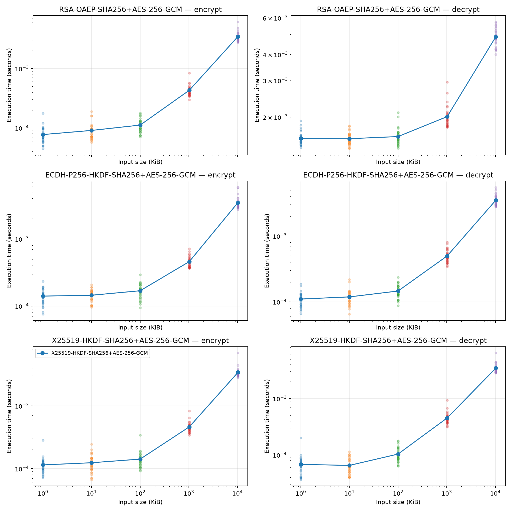
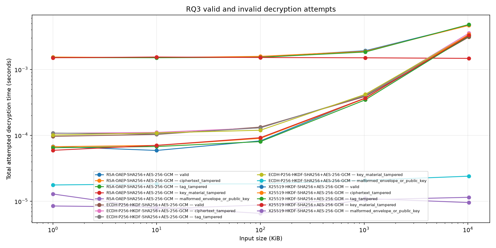

# COSC2539 Asymmetric-Based Hybrid Encryption: Experimental Report

**Project:** Cryptography Under Adversarial Conditions

**Scope:** RSA-OAEP + AES-256-GCM; ECDH P-256 + HKDF-SHA256 + AES-256-GCM; X25519 + HKDF-SHA256 + AES-256-GCM

**Archived run:** `run_20261119_01`
**Collection time:** 2026-11-18 UTC (local date 2026-11-19), as recorded in run metadata.

## Executive summary

All three approved hybrid schemes completed RQ1 (900 timings), RQ2 (85 functional cases), and RQ3 (2,250 timings). RQ1 repeated-measures ANOVA produced Holm-adjusted omnibus p-values below 0.05 for all six scheme-operation combinations. However, sphericity was rejected in all six analyses, so Greenhouse-Geisser correction was applied; residual and difference-score normality diagnostics also rejected normality. The findings support a strong observed input-size association, but the nominal ANOVA inference needs cautious interpretation.

RQ2 behaved as expected in all 85 cases: all 15 valid envelopes were accepted and released the original plaintext; all 70 invalid cases were rejected without releasing plaintext. RQ3 generated 60 planned matched valid-versus-invalid contrasts. Its analysis detected lag-1 dependence across sequential blocks, so all RQ3 inference is downgraded to conditional/exploratory. Seventeen Holm-adjusted p-values are below 0.05, concentrated in malformed-input cases (15) and key-material tampering (2); these are not confirmatory findings under the detected dependence. No non-significant result is evidence of timing equivalence.

## Experimental setup

| Item | Recorded setup |
|---|---|
| Payload sizes | 1 KiB, 10 KiB, 100 KiB, 1 MiB, 10 MiB (1,024 through 10,485,760 bytes) |
| RQ1 design | 30 randomized complete blocks × 30 scheme/size/operation conditions = 900 measured rows; 5 warm-ups per condition excluded |
| RQ2 design | 85 distinct functional cases; no timing inference |
| RQ3 design | 30 randomized blocks × 75 scheme/size/scenario conditions = 2,250 measured rows; 5 warm-ups per condition excluded |
| Input buffers | Deterministic seeded pseudo-random bytes, prepared outside timing; a given block/size buffer is shared across schemes and scenarios |
| Timing clock | `time.perf_counter()`; input generation, cryptographic recipient-key setup, mutations, digest/envelope preparation, CSV output, and plotting excluded |
| RSA key size | 3,072 bits, generated once per experiment setup |
| Python / host | Python 3.14.10; Gentoo Linux 6.18.60; Intel 13th Gen Core i5-13420H |
| Crypto / analysis stack | OpenSSL 3.6.5; cryptography 50.0.2; NumPy 2.5.5; SciPy 1.18.1; statsmodels 0.15.0; pandas 3.1.1; Matplotlib 3.11.2 |
| Randomness | Experiment schedule seeds recorded from OS entropy; cryptographic keys/nonces/salts/ephemeral secrets use cryptographic randomness independently |

### Timing scope

RQ1 encryption times cover the full per-message operation: RSA includes random AES session-key generation, AES-GCM encryption, and OAEP-SHA256 wrapping; ECDH and X25519 include ephemeral key generation, key agreement, HKDF-SHA256, and AES-GCM encryption. Decryption covers RSA OAEP unwrapping plus authenticated AES-GCM decryption, or public-key processing/key agreement/HKDF plus AES-GCM decryption for ECDH and X25519. Long-term recipient key generation and input/envelope preparation are outside the measured interval.

RQ3 times cover the complete decryption attempt through success or rejection. Mutated envelopes are prepared before timing. This means early parsing, public-key parsing, and RSA-OAEP failures naturally take different paths and amounts of work from AES-GCM authentication failures.

## RQ1: payload-size effect

The table reports **mean / median milliseconds** from 30 block observations in each cell. It summarizes each scheme and operation separately; it is descriptive and does not constitute between-scheme hypothesis testing.

| Scheme and operation | 1 KiB | 10 KiB | 100 KiB | 1 MiB | 10 MiB |
|---|---:|---:|---:|---:|---:|
| ECDH P-256 + HKDF-SHA256 + AES-256-GCM — encrypt | 0.1406 / 0.1364 | 0.1448 / 0.1473 | 0.169 / 0.1667 | 0.4597 / 0.444 | 3.483 / 3.238 |
| ECDH P-256 + HKDF-SHA256 + AES-256-GCM — decrypt | 0.1102 / 0.1101 | 0.1189 / 0.1157 | 0.146 / 0.1345 | 0.4987 / 0.4595 | 3.506 / 3.245 |
| RSA-OAEP + AES-256-GCM — encrypt | 0.07737 / 0.06942 | 0.09079 / 0.08715 | 0.1117 / 0.1023 | 0.4305 / 0.4119 | 3.453 / 3.268 |
| RSA-OAEP + AES-256-GCM — decrypt | 1.58 / 1.539 | 1.574 / 1.553 | 1.612 / 1.575 | 2.01 / 1.93 | 4.869 / 4.861 |
| X25519 + HKDF-SHA256 + AES-256-GCM — encrypt | 0.1146 / 0.1087 | 0.1241 / 0.1117 | 0.1418 / 0.135 | 0.4625 / 0.4511 | 3.403 / 3.243 |
| X25519 + HKDF-SHA256 + AES-256-GCM — decrypt | 0.06793 / 0.06474 | 0.06515 / 0.0606 | 0.1035 / 0.09271 | 0.4525 / 0.4282 | 3.457 / 3.289 |

Full descriptive statistics (standard deviation, minimum, maximum, and MiB/s throughput) are available for every cell in `rq1/analysis/run_20261119_01/asymmetric_rq1_descriptive.csv`.



### Conventional one-factor repeated-measures ANOVA

The within-subject factor is input size (five levels); block is the subject (30 subjects). The null hypothesis for each of six separate tests is equal mean execution time across all five input sizes; the alternative is that at least one size mean differs. Alpha is 0.05. Holm correction covers the six omnibus tests. Where Mauchly rejects sphericity, the same F statistic is evaluated with Greenhouse-Geisser corrected degrees of freedom. Partial eta-squared is the reported effect size.

| Scheme / operation | F | GG df (num, den) | Mauchly p | εGG | GG p | Holm p | Partial η² | Residual Shapiro p | Min difference-score Shapiro p |
|---|---:|---:|---:|---:|---:|---:|---:|---:|---:|
| RSA-OAEP + AES-256-GCM — encrypt | 644.63 | (1.043, 30.260) | 2.21e-63 | 0.261 | 3.48e-22 | 1.39e-21 | 0.957 | 1.56e-15 | 3.43e-05 |
| RSA-OAEP + AES-256-GCM — decrypt | 1192.94 | (1.689, 48.980) | 2.64e-16 | 0.422 | 8.88e-41 | 5.33e-40 | 0.976 | 7.57e-07 | 1.00e-05 |
| ECDH P-256 + HKDF-SHA256 + AES-256-GCM — encrypt | 556.36 | (1.035, 30.015) | 1.85e-60 | 0.259 | 4.16e-21 | 8.33e-21 | 0.950 | 1.28e-16 | 2.25e-06 |
| ECDH P-256 + HKDF-SHA256 + AES-256-GCM — decrypt | 671.17 | (1.059, 30.717) | 1.57e-57 | 0.265 | 9.66e-23 | 4.83e-22 | 0.959 | 3.89e-11 | 2.04e-03 |
| X25519 + HKDF-SHA256 + AES-256-GCM — encrypt | 542.94 | (1.037, 30.068) | 1.11e-57 | 0.259 | 5.48e-21 | 8.33e-21 | 0.949 | 3.31e-20 | 1.27e-08 |
| X25519 + HKDF-SHA256 + AES-256-GCM — decrypt | 631.29 | (1.046, 30.335) | 1.68e-66 | 0.262 | 4.22e-22 | 1.39e-21 | 0.956 | 1.10e-16 | 3.04e-06 |

All six Mauchly tests rejected sphericity (p < 0.05), and Greenhouse-Geisser correction was used for all six. The residual Shapiro-Wilk tests and the minimum of ten within-subject difference-score Shapiro-Wilk tests also rejected normality for all six combinations. Greenhouse-Geisser corrects the sphericity issue; it does not repair non-normal residuals or establish independent blocks. The observed partial eta-squared values are large, but they are not a measure of practical value or proof that every pair of input sizes differs. An omnibus result identifies only that at least one mean differs.

At α = 0.05, all six Holm-adjusted RM-ANOVA p-values are below 0.05. Given the rejected normality diagnostics and the sequential block design, report these as strong but assumption-sensitive evidence of an input-size effect, not as assumption-free results.

### Complementary position-adjusted OLS analysis

The retained adjusted model is position-adjusted block-fixed-effects OLS with CR1 cluster-robust covariance by block. It tests the input-size coefficients after block and centered linear randomized position; the approximate Wald reference is F(4, 29). This is a sensitivity analysis, **not** conventional one-way repeated-measures ANOVA. Holm adjustment covers its six omnibus tests.

| Scheme / operation | Wald F(4,29) | Holm p | Diagnostic flag | OLS pairwise comparisons |
|---|---:|---:|---|---|
| RSA-OAEP + AES-256-GCM — encrypt | 213.32 | 1.87e-20 | block_order_trend | omitted: diagnostic flag |
| RSA-OAEP + AES-256-GCM — decrypt | 459.14 | 5.50e-25 | serial_dependence_between_blocks | omitted: diagnostic flag |
| ECDH P-256 + HKDF-SHA256 + AES-256-GCM — encrypt | 113.51 | 2.83e-17 | None flagged | performed; Holm adjustment across ten size pairs within this scheme-operation |
| ECDH P-256 + HKDF-SHA256 + AES-256-GCM — decrypt | 185.78 | 6.45e-20 | None flagged | performed; Holm adjustment across ten size pairs within this scheme-operation |
| X25519 + HKDF-SHA256 + AES-256-GCM — encrypt | 204.95 | 2.46e-20 | None flagged | performed; Holm adjustment across ten size pairs within this scheme-operation |
| X25519 + HKDF-SHA256 + AES-256-GCM — decrypt | 310.55 | 1.18e-22 | None flagged | performed; Holm adjustment across ten size pairs within this scheme-operation |

The adjusted OLS omnibus tests were below 0.05 after Holm correction in all six combinations. Pairwise OLS contrasts were reported for four combinations only (40 total, 10 size pairs each); RSA encryption had a block-order trend flag and RSA decryption a serial-dependence flag, so pairwise inference was omitted for those two. The complete contrast-level results and intervals are in `results/asymmetric/rq1/analysis/run_20261119_01/asymmetric_rq1_pairwise.csv`. The OLS diagnostics also reject residual normality throughout; the model is complementary evidence, not a cure-all.

## RQ2: adversarial functional outcomes

All 85 rows in the expected-versus-observed case validation file match the planned behavior. There were 15 valid cases and 70 invalid cases. Every invalid case was rejected without releasing plaintext; every valid case released the original plaintext. These counts are functional checks, not estimates of attack probabilities.

| Scenario | Cases | Accepted | Rejected | Plaintext released | Observed failure stage |
|---|---:|---:|---:|---:|---|
| `valid` | 15 | 15 | 0 | 15 | accepted: 15 |
| `ciphertext_tampered` | 15 | 0 | 15 | 0 | aes_gcm_authentication: 15 |
| `tag_tampered` | 15 | 0 | 15 | 0 | aes_gcm_authentication: 15 |
| `wrapped_key_tampered` | 5 | 0 | 5 | 0 | rsa_oaep_unwrap: 5 |
| `valid_replacement_public_key` | 10 | 0 | 10 | 0 | aes_gcm_authentication: 10 |
| `malformed_public_key` | 10 | 0 | 10 | 0 | public_key_parse: 10 |
| `malformed_common_envelope_field` | 15 | 0 | 15 | 0 | envelope_validation: 15 |

For the ECDH/X25519 valid replacement-public-key cases, key agreement and HKDF completed and AES-GCM rejected the envelope. Malformed public keys failed during parsing. RSA wrapped-key tampering failed at OAEP unwrapping. No failure path returned unauthenticated plaintext. These schemes do not authenticate the sender: anyone with a recipient public key can construct an envelope that decrypts successfully for that recipient.

## RQ3: valid-versus-invalid processing time

The 2,250 raw observations form 30 complete randomized blocks. Each block has one observation for each scheme × size × scenario, with position 1–75 appearing exactly once. For each scheme/size/invalid-scenario contrast, the analysis pairs 30 invalid attempts with the 30 valid attempts from the same blocks. Positive difference means the invalid attempt took longer. Holm adjustment was applied across all 60 planned comparisons.

| RQ3 scenario | Observations | Observed completion/failure stages | Plaintext released for invalid rows |
|---|---:|---|---:|
| Valid | 450 | All accepted; key unwrap/agreement, HKDF where applicable, and GCM completed | n/a |
| Ciphertext tampering | 450 | 450 reached and failed AES-GCM authentication | 0 |
| Tag tampering | 450 | 450 reached and failed AES-GCM authentication | 0 |
| Key-material tampering | 450 | 150 RSA cases failed OAEP unwrap; 300 ECDH/X25519 cases reached and failed AES-GCM authentication after agreement/HKDF | 0 |
| Malformed envelope/public key | 450 | 150 RSA cases failed envelope validation; 300 ECDH/X25519 cases failed public-key parsing | 0 |

| Invalid scenario | Contrasts (scheme × size) | Mean of 15 contrast mean differences (ms) | Range (ms) | Mean of 15 contrast mean changes (%) | Holm p < .05 |
|---|---:|---:|---:|---:|---:|
| `ciphertext_tampered` | 15 | 0.04269 | -0.05701 to 0.45033 | 8.66% | 0/15 |
| `key_material_tampered` | 15 | -0.22064 | -3.25311 to 0.26839 | -0.21% | 2/15 |
| `malformed_envelope_or_public_key` | 15 | -1.24598 | -4.71800 to -0.05097 | -93.21% | 15/15 |
| `tag_tampered` | 15 | 0.01042 | -0.08528 to 0.16666 | 5.05% | 0/15 |

Across all 60 contrasts, 17 Holm-adjusted p-values were below 0.05: 15 malformed-input comparisons and 2 key-material-tampering comparisons. None of the ciphertext-tampering or tag-tampering contrasts was below 0.05 after the family-wide correction. The 15 malformed-input differences reflect work ending during envelope/public-key parsing rather than completing key derivation and GCM verification; the key-material condition also has scheme-specific failure stages. They should not be read as a common “invalid ciphertext is faster” effect.



The sign-swap test is conditional on the within-block complete-condition shuffle and its finite-state PRNG approximation. Its sharp null is that swapping the valid and a given invalid label between their two assigned positions changes no outcome at either position in any block. It also requires no consequential carry-over/interference. The block residual mean had lag-1 correlation 0.426 (p = 0.0213); the analysis therefore marks all RQ3 inference conditional/exploratory. This diagnostic does not prove the source of dependence, but it makes unqualified confirmatory claims inappropriate. The linear position slope test (p = 0.693), position-by-condition family test (p = 0.801), previous-condition joint test (p = 0.137), and block linear trend test (p = 0.635) were not flagged; non-significance does not prove no position or carry-over effect.

No block-bootstrap confidence intervals were emitted for the 60 contrasts because diagnostics flagged block dependence and the implemented interval procedure assumes independent blocks. All 60 row-level results, absolute/percentage differences, raw and adjusted p-values, and inference statuses are retained in `rq3/analysis/run_20261119_01/asymmetric_rq3_paired_tests.csv`. The non-significant results do **not** establish equivalence; no application-specific equivalence margin was specified.

## Research-question answers

**RQ1 — input size and execution time.** In this machine and these runs, mean encryption and decryption time increased substantially from 1 KiB to 10 MiB for each scheme. The six separate repeated-measures omnibus tests were significant after Holm correction and had partial eta-squared between approximately 0.949 and 0.976. Sphericity was handled with Greenhouse-Geisser correction, but residual and difference-score normality were rejected and blocks were sequential. This is strong observed size association with assumption-related uncertainty, not evidence that all pairwise sizes differ or that one scheme is generally fastest.

**RQ2 — tampering and invalid inputs.** AES-GCM detected all tested ciphertext/tag modifications; RSA rejected modified wrapped keys during OAEP unwrap; modified valid ECDH/X25519 replacement keys reached GCM and failed authentication; malformed envelope/key fields were rejected at validation or parsing. No invalid case released plaintext. These results demonstrate the implementation’s tested behavior, not a probability estimate or sender identity guarantee.

**RQ3 — valid/invalid processing time.** The experiment measured local end-to-end decryption-attempt time for five distinct invalid paths, not a single generic invalid-ciphertext cost. Malformed-input cases were typically much faster because processing stopped early; ciphertext/tag cases reached AES-GCM and their paired contrasts did not survive Holm adjustment. Two key-material contrasts and all malformed-input contrasts had adjusted p < 0.05, but the lag-1 dependence diagnostic requires exploratory interpretation. These data do not establish equivalence or end-to-end attacker cost.

## Limitations and threats to validity

- One host, software stack, library build, and execution environment; results may not generalize to other systems or deployments.
- One deterministic seeded pseudo-random payload per size per block was used (30 payloads per size); within each block, that buffer is shared across schemes, operations, and scenarios. This does not characterize all possible payload contents or application workloads.
- Thirty blocks are sequential observations. Randomized order reduces systematic order bias but cannot establish independence or eliminate carry-over. RQ3 specifically flagged lag-1 dependence.
- RQ1 RM-ANOVA sphericity and normality diagnostics reject assumptions. Greenhouse-Geisser addresses sphericity only; small sample/block count and non-normal residuals remain caveats.
- RQ1 adjusted OLS uses an approximate finite-cluster CR1 reference with 30 clusters; its own residual and serial/trend diagnostics also warrant caution.
- RQ3 conditional sign-swap inference depends on the schedule-generation approximation, sharp-null interpretation, and no-interference/no-carry-over assumption; it is explicitly exploratory after diagnostics.
- No equivalence margin, deployment threshold, network cost, file I/O cost, or attacker key-generation cost was included. RQ3 compares local decrypt attempts only.
- Hybrid encryption with AES-GCM provides confidentiality and authenticated integrity to the recipient, but not sender authentication or non-repudiation.

## Reproduction commands and files

The commands below are the commands used for the archived run (from the project root). Their output directories already exist and refuse overwriting. For a new collection, use a new run ID and point analysis at that new raw CSV and metadata. RQ1, RQ2, and RQ3 were run sequentially.

### RQ1

```sh
PYTHONDONTWRITEBYTECODE=1 MPLCONFIGDIR=/tmp/cosc2539-mpl .venv/bin/python -u -m asymmetric.experiment_runner --output-dir results/asymmetric/rq1/runs/run_20261119_01
PYTHONDONTWRITEBYTECODE=1 MPLCONFIGDIR=/tmp/cosc2539-mpl .venv/bin/python -u -m asymmetric.statistical_analysis rq1 --input-csv results/asymmetric/rq1/runs/run_20261119_01/asymmetric_rq1_benchmarks.csv --metadata results/asymmetric/rq1/runs/run_20261119_01/asymmetric_rq1_metadata.json --output-dir results/asymmetric/rq1/analysis/run_20261119_01
```

### RQ2

```sh
PYTHONDONTWRITEBYTECODE=1 MPLCONFIGDIR=/tmp/cosc2539-mpl .venv/bin/python -u -m asymmetric.adversarial_runner rq2 --output-dir results/asymmetric/rq2/runs/run_20261119_01
PYTHONDONTWRITEBYTECODE=1 MPLCONFIGDIR=/tmp/cosc2539-mpl .venv/bin/python -u -m asymmetric.statistical_analysis rq2 --input-csv results/asymmetric/rq2/runs/run_20261119_01/asymmetric_rq2_outcomes.csv --metadata results/asymmetric/rq2/runs/run_20261119_01/asymmetric_rq2_metadata.json --output-dir results/asymmetric/rq2/analysis/run_20261119_01
```

### RQ3

```sh
PYTHONDONTWRITEBYTECODE=1 MPLCONFIGDIR=/tmp/cosc2539-mpl .venv/bin/python -u -m asymmetric.adversarial_runner rq3 --output-dir results/asymmetric/rq3/runs/run_20261119_01
PYTHONDONTWRITEBYTECODE=1 MPLCONFIGDIR=/tmp/cosc2539-mpl .venv/bin/python -u -m asymmetric.statistical_analysis rq3 --input-csv results/asymmetric/rq3/runs/run_20261119_01/asymmetric_rq3_verification.csv --metadata results/asymmetric/rq3/runs/run_20261119_01/asymmetric_rq3_metadata.json --output-dir results/asymmetric/rq3/analysis/run_20261119_01 --analysis-seed 20261118
```

### Generated outputs

| Group | Raw data and metadata | Analysis outputs |
|---|---|---|
| RQ1 | `rq1/runs/run_20261119_01/asymmetric_rq1_benchmarks.csv`; `asymmetric_rq1_metadata.json`; `execution.log` | Descriptive CSV, repeated-measures ANOVA CSV, adjusted OLS CSV, pairwise CSV, JSON summary, execution-time PNG, `analysis.log` under `rq1/analysis/run_20261119_01/` |
| RQ2 | `rq2/runs/run_20261119_01/asymmetric_rq2_outcomes.csv`; `asymmetric_rq2_metadata.json`; `execution.log` | Outcome summary CSV, expected-versus-observed validation CSV, JSON summary, `analysis.log` under `rq2/analysis/run_20261119_01/` |
| RQ3 | `rq3/runs/run_20261119_01/asymmetric_rq3_verification.csv`; `asymmetric_rq3_metadata.json`; `execution.log` | Descriptive CSV, 60 paired-test CSV, diagnostics CSV, JSON summary, execution-time PNG, `analysis.log` under `rq3/analysis/run_20261119_01/` |

Full descriptive output, analysis parameters, software versions, and raw CSV checksums are recorded in the generated metadata/summary JSON files. The raw observations are the source of record; do not edit them.

## Final validation

- Full test command: `PYTHONDONTWRITEBYTECODE=1 MPLCONFIGDIR=/tmp/cosc2539-mpl .venv/bin/python -m unittest discover -s tests -v` — **58 tests passed**, 0 failed, in 5.469 seconds.
- Raw-data integrity: RQ1 has 900 unique planned rows; RQ2 has 85 cases and all 85 expected-versus-observed checks match; RQ3 has 2,250 unique planned rows and 60 matched contrasts. No invalid RQ2/RQ3 case released plaintext.
- Analysis summaries' recorded raw CSV SHA-256 values match their respective raw files.
- All 14 pre-existing Hashing raw/analysis CSV checksums match the pre-run snapshot; Hashing result data were preserved.
- `git diff --check` passed.
